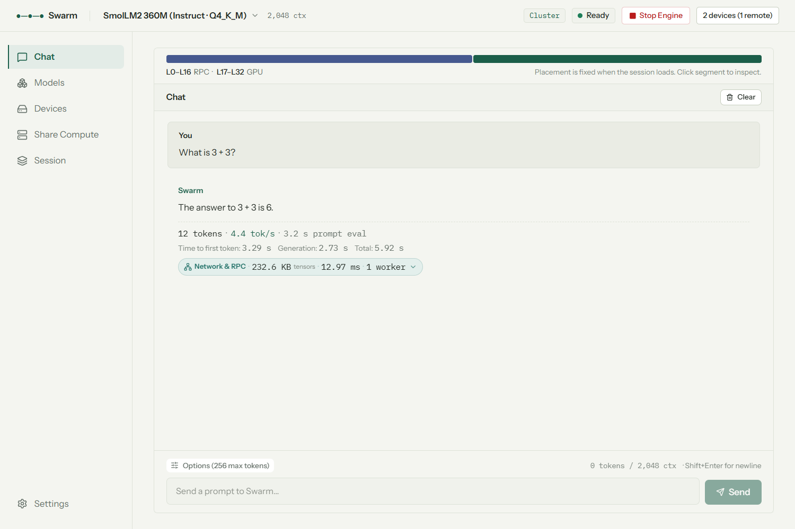
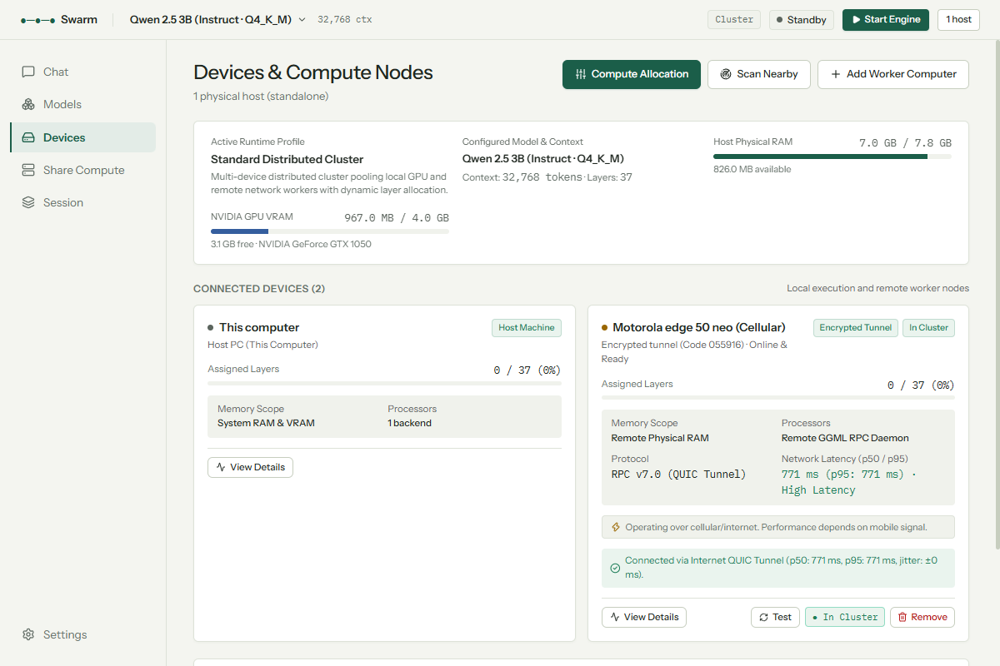
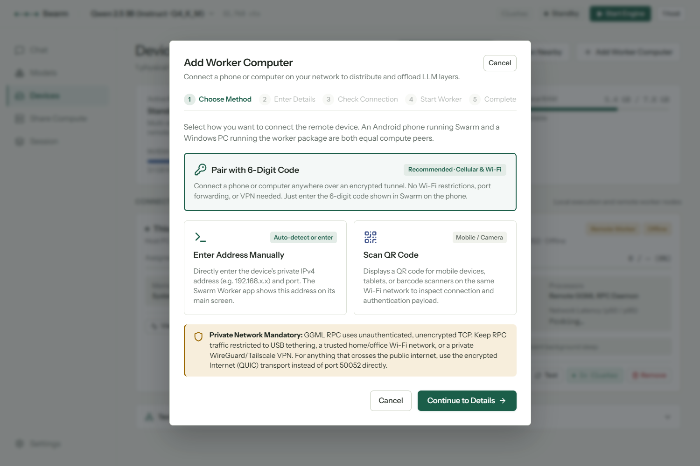
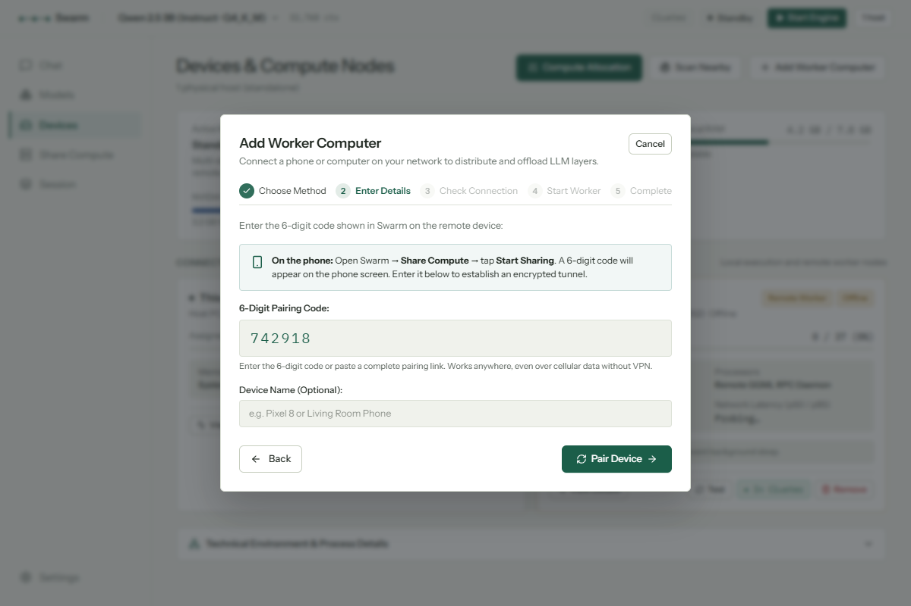
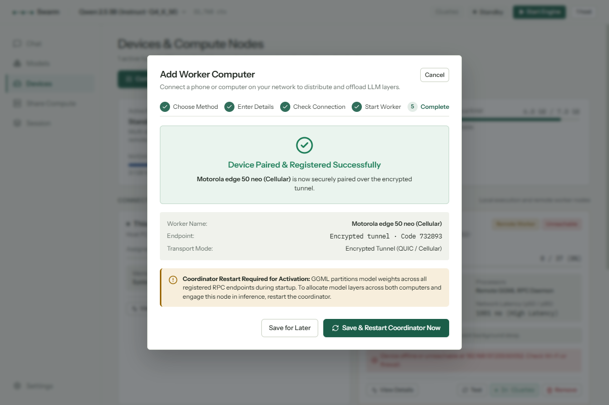
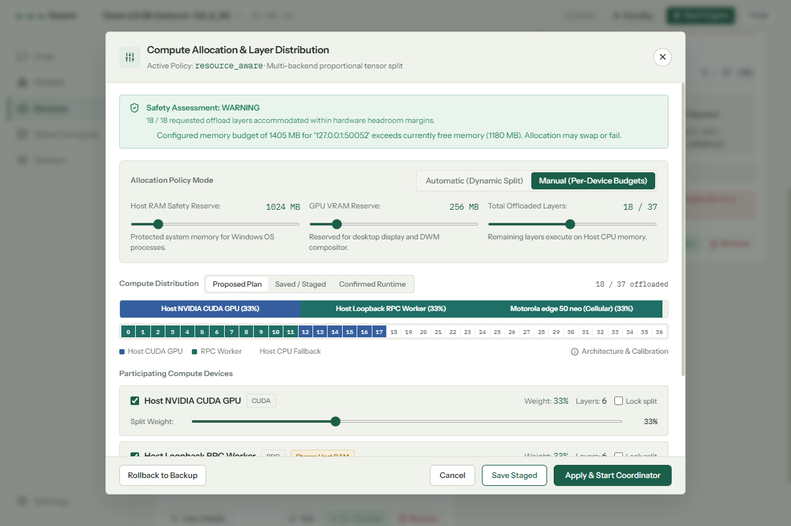
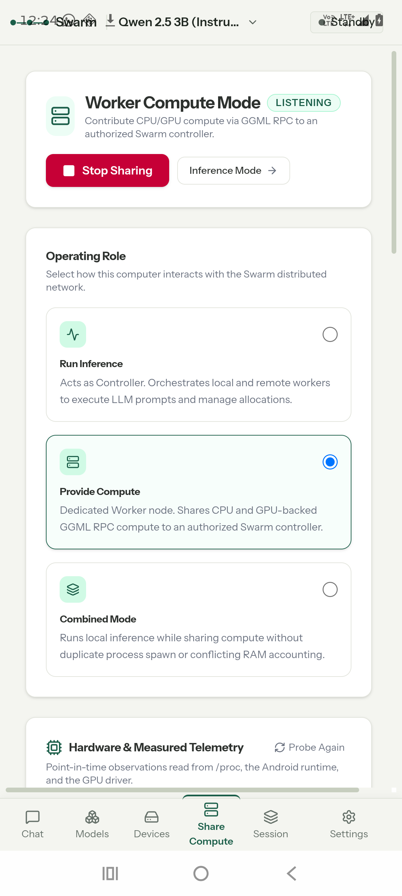
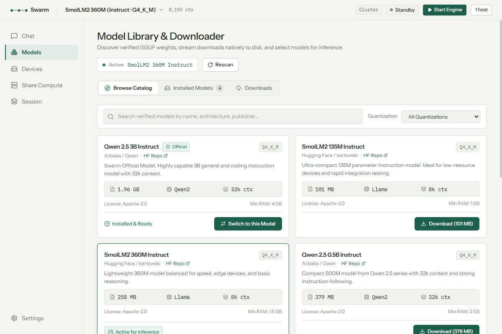
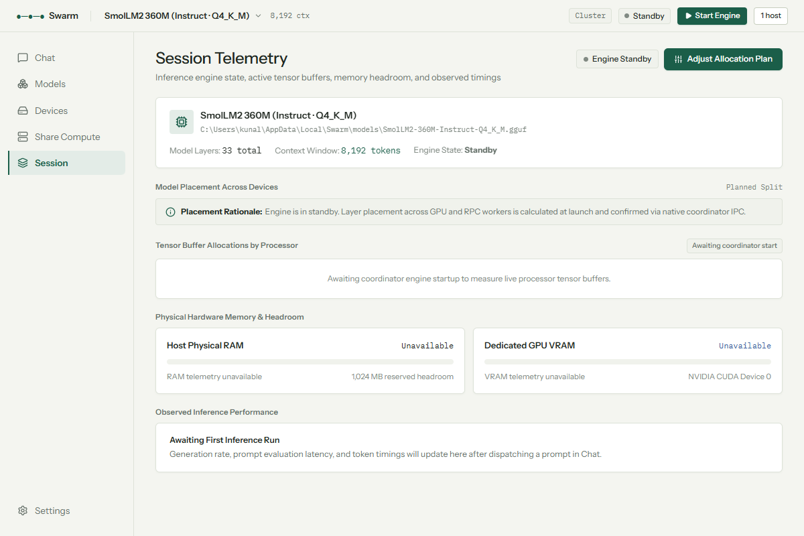
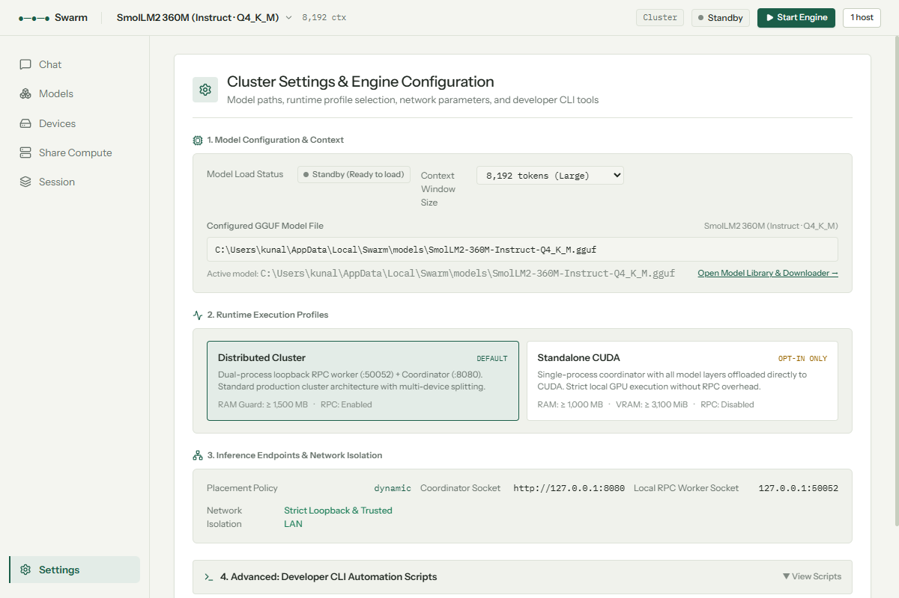

# Swarm

<div align="center">

**Heterogeneous Distributed LLM Inference Across Consumer GPUs, PCs, and Mobile Devices**

[](CMakeLists.txt)
[](spike/desktop-shell/src-tauri)
[](https://tauri.app)
[](ui/)
[](spike/desktop-shell/src-tauri/gen/android)
[](https://developer.nvidia.com/cuda-toolkit)
[](https://iroh.computer)
[](LICENSE)

*Run larger open-weights language models by pooling the compute and memory of devices you already own — from desktop gaming GPUs to smartphones on cellular data.*

[Key Features](#key-features) • [Visual Tour](#visual-tour) • [Architecture](#architecture--dataflow) • [Quick Start](#quick-start) • [Building from Source](#building-from-source) • [Pairing Guide](#zero-config-cellular-pairing)

</div>

---

## Overview

**Swarm** is an open-source, local-first distributed inference platform that partitions transformer layers across heterogeneous compute nodes. Rather than requiring expensive server-grade enterprise hardware, Swarm turns everyday hardware into a collaborative cluster:

- **Desktop Host:** Houses the primary coordinator, Web API gateway, and local NVIDIA CUDA GPU (e.g. GTX 1050/1650, RTX 20/30/40 series).
- **Mobile Worker:** Runs on consumer Android smartphones (ARM64 CPU / Vulkan) via an optimized background foreground service.
- **Encrypted Peer-to-Peer Tunnel:** Traverses carrier-grade NAT (CGNAT) and university firewalls over cellular data using authenticated Iroh QUIC with **zero** external VPNs, port forwarding, or accounts.
- **Process Supervisor:** Windows Job Object confinement guarantees that helper processes never outlive the user interface.

---

## Visual Tour

<div align="center">

### 1. Unified Desktop Chat & Live Distributed Inference
*Streaming response execution with live token timing, real-time context metrics, and hardware utilization.*



---

### 2. Devices Dashboard & Live Cluster Inventory
*Heterogeneous cluster view showing the Host PC and a remote Motorola phone paired over cellular data with measured sub-second QUIC latency.*



---

### 3. In-App 6-Digit Device Onboarding
*Zero-configuration pairing workflow: select 6-digit code, enter the number displayed on the phone, and establish an encrypted QUIC tunnel in seconds.*

| Step 1: Pairing Method Selection | Step 2: 6-Digit Code Entry | Step 3: Verified Tunnel Confirmation |
| :---: | :---: | :---: |
|  |  |  |

---

### 4. Interactive Compute Allocation & Tensor Layer Distribution
*Visual layer partitioning across Host NVIDIA CUDA GPU, Host Loopback Worker, and Remote Mobile Phone with safety headroom enforcement.*



---

### 5. Mobile Worker Mode (Android)
*Dedicated background compute node on Android with CPU/Vulkan acceleration, partial wake lock, and low-latency Wi-Fi lock.*



---

### 6. HuggingFace Model Explorer & Observability Workbench
*Built-in catalog browser for downloading GGUF quantizations and deep session telemetry monitoring memory pools and active graph buffers.*

| HuggingFace GGUF Model Catalog | Real-Time Session Buffer Telemetry | System Workbench & Process Controls |
| :---: | :---: | :---: |
|  |  |  |

</div>

---

## Key Features

- **Heterogeneous Tensor Parallelism:**
  Offload model transformer layers proportionally across disparate backends:
  - Local NVIDIA CUDA GPUs
  - Host System Physical RAM (CPU fallback)
  - Remote Android phone workers (ARM NEON / Vulkan)
  - Remote Windows helper PCs

- **Cellular & Internet Traversal (`swarm-tunnel`):**
  Uses [Iroh](https://iroh.computer) QUIC with state-of-the-art hole punching, DERP relay fallback, and PKARR decentralized discovery. Devices on 4G/5G carrier-grade NAT (CGNAT) connect directly to home or university desktops without Tailscale, WireGuard, or open router ports.

- **Human-Friendly 6-Digit In-App Pairing:**
  Both endpoints expand the ephemeral 6-digit code using SHA-256 (`swarm-pair-v1:` domain prefix) into matching cryptographic node identities. No rendezvous servers, user accounts, or cloud databases.

- **Native Android Worker (`com.swarm.desktop`):**
  Packaged as an Android APK featuring:
  - Background foreground service with persistent notification
  - `PowerManager.PARTIAL_WAKE_LOCK` to prevent CPU sleep during inference
  - `WifiManager.WIFI_MODE_FULL_LOW_LATENCY` to suppress mobile Wi-Fi latency jitter
  - Native arm64 binaries for `ggml-rpc-server` and `swarm-tunnel`

- **Process Supervision & Safety:**
  The Rust Tauri supervisor enforces Windows Job Object confinement (`JOB_OBJECT_LIMIT_KILL_ON_JOB_CLOSE`), silent background execution (`CREATE_NO_WINDOW`), port collision auto-recovery, and fail-closed transaction rollbacks.

- **Dynamic Memory Safety Planner:**
  Before offloading layers, the allocation planner inspects OS free memory and display compositor requirements. If a target exceeds safe hardware headroom, layers gracefully fall back to CPU memory.

---

## Architecture & Dataflow

```
┌────────────────────────────────────────────────────────────────────────────────────────┐
│                                   Swarm Desktop GUI                                    │
│             (React 19 / TypeScript / Vite / TailwindCSS / Lucide / Radix UI)           │
└───────────────────────────────────────────┬────────────────────────────────────────────┘
                                            │ Tauri IPC Commands
┌───────────────────────────────────────────▼────────────────────────────────────────────┐
│                    Tauri Native Supervisor (Rust) — [PID Confinement]                  │
│  - Windows Job Object Manager               - Port Allocator & Health Probing          │
│  - Iroh Tunnel Dialer Daemon (`dial`)       - Dynamic Allocation Planner               │
└───────────────────┬───────────────────────────────────────────────┬────────────────────┘
                    │ Child Process Spawn                           │ Localhost TCP (127.0.0.1:local_port)
┌───────────────────▼──────────────────────┐    ┌───────────────────▼────────────────────┐
│         Swarm Coordinator (C++)          │    │         `swarm-tunnel dial` (Rust)     │
│  - HTTP API Gateway (Port 8080)          │    │  - Ephemeral QUIC Endpoint             │
│  - GGML RPC v7 Distributed Client        │    │  - DERP Relay & Hole Punching          │
│  - Local CUDA Offload (NVIDIA GPU)       │    └───────────────────┬────────────────────┘
└───────────────────┬──────────────────────┘                        │
                    │                                               │ Encrypted QUIC over Cellular / Internet
                    │ Local TCP Loopback                            │ (ALPN: swarm/rpc/1)
                    │ (Port 50052)                                  │
┌───────────────────▼──────────────────────┐    ┌───────────────────▼────────────────────┐
│     Local Host RPC Worker (C++)          │    │    Mobile Phone: `swarm-tunnel serve`  │
│  - ggml-rpc-server (127.0.0.1)           │    │  - Derived Key from 6-Digit Code       │
│  - System RAM Tensor Pool                │    │  - Decrypts QUIC -> Pipes to localhost │
└──────────────────────────────────────────┘    └───────────────────┬────────────────────┘
                                                                    │ Local Loopback (0.0.0.0:50052)
                                                ┌───────────────────▼────────────────────┐
                                                │   Android Worker: `libggml_rpc.so`     │
                                                │  - ARM64 CPU (NEON) / Vulkan GPU       │
                                                │  - Physical Mobile RAM Tensor Pool     │
                                                └────────────────────────────────────────┘
```

### Distributed Inference Pipeline

```
User Prompt
    │
    ▼
Swarm Coordinator (C++ / llama.cpp)
    │
    ├── Layer  0 .. 11 ──► Local NVIDIA CUDA GPU (VRAM)
    ├── Layer 12 .. 23 ──► Local Host CPU Worker (System RAM)
    └── Layer 24 .. 36 ──► Encrypted QUIC Tunnel ──► Mobile Phone (Android RAM)
                                                              │
                                                     ARM64 Compute (NEON)
                                                              │
Token Stream ◄── Tensor Activations Returned Over Tunnel ─────┘
```

---

## Zero-Config Cellular Pairing

No VPNs. No public IP. No router port forwarding.

```
       PHONE (Cellular Data / 4G / 5G)                     DESKTOP PC (Home / Office / Campus)
    ┌───────────────────────────────────┐               ┌──────────────────────────────────────┐
    │ 1. Open Swarm -> Share Compute    │               │ 1. Open Devices -> Add Device        │
    │ 2. Tap "Start Sharing"            │               │ 2. Select "Pair with 6-Digit Code"   │
    │ 3. Displays Code: [ 7 3 2 8 9 3 ] │               │ 3. Enter Code:    [ 7 3 2 8 9 3 ]    │
    └─────────────────┬─────────────────┘               └──────────────────┬───────────────────┘
                      │                                                    │
             SHA-256("swarm-pair-v1:732893")                      SHA-256("swarm-pair-v1:732893")
                      │                                                    │
            Matching SecretKey / EndpointId                      Matching Peer EndpointId
                      │                                                    │
             `swarm-tunnel serve`                                 `swarm-tunnel dial`
                      │                                                    │
                      └─────────────► [ Iroh QUIC Handshake ] ◄────────────┘
                                     (Encrypted Hole-Punch / Relay)
                                                   │
                                      Live RPC Bridge Established
                                            (p50: ~170 ms)
```

---

## Verified Benchmarks & Real-World Results

Tested on physical consumer hardware across heterogeneous networks:

| Device Role | Hardware Specifications | Backend | Network Type | Connection Latency |
| :--- | :--- | :--- | :--- | :--- |
| **Host Coordinator** | Intel x86_64, 8 GB RAM, NVIDIA GeForce GTX 1050 (4 GB VRAM) | CUDA 12 + CPU | Ethernet (Campus LAN behind NAT) | Local Loopback (< 1 ms) |
| **Mobile Worker** | Motorola Edge 50 Neo (MediaTek Dimensity 7300, 8 Cores, 8 GB RAM) | ARM64 NEON | 5G Cellular Data (Carrier CGNAT `192.0.0.4`) | **171 ms (p50)** via Iroh QUIC |

### Live Test Metrics
- **Tunnel Handshake**: Verified end-to-end QUIC handshake in **0.33 seconds**.
- **RPC Command Roundtrip**: GGML RPC v7 `HELLO` command dispatched from Windows PC across cellular network to phone and validated in **200 ms**.
- **Model Distribution**: Reference baseline **Qwen 2.5 3B Instruct (Q4_K_M)** split cleanly: 33% CUDA GPU, 33% Host Worker, 33% Motorola Phone.

---

## Quick Start

### 1. Download & Launch Desktop App

Download the latest installer from the Releases page:
- **Windows Installer (`.exe`):** `Swarm Desktop_0.1.0_x64-setup.exe`
- Run the application. The Rust supervisor will automatically configure runtime profiles and model directories.

### 2. Download a Model

1. Go to the **Models** tab in the desktop app.
2. Select **Qwen 2.5 3B Instruct** (or browse HuggingFace GGUF models).
3. Click **Download**. The model will be placed in your local model library.

### 3. Pair Your Phone (Optional for Multi-Device)

1. Install `app-arm64-debug.apk` on your Android phone.
2. Open Swarm on the phone, go to **Share Compute**, and tap **Start Sharing**.
3. On the PC, go to **Devices** → **Add Worker Computer** → **Pair with 6-Digit Code**.
4. Enter the 6 digits shown on the phone and click **Pair Device**.
5. Click **Start Engine** to begin distributed inference!

---

## Building from Source

### Prerequisites

| Component | Required Toolchain |
| :--- | :--- |
| **C++ Engine** | Visual Studio 2022 (MSVC v143), CMake 3.14+, NMake, CUDA Toolkit 12.x |
| **Rust Supervisor** | Rust 1.80+ (stable x86_64-pc-windows-msvc) with Cargo |
| **Frontend UI** | Node.js v18+ and npm |
| **Android APK** | Android SDK 34, Android NDK 27.2.12479018, Java JDK 21 |
| **Cross-Compilation** | `rustup target add aarch64-linux-android` |

---

### Step 1: Build the C++ Inference Engine

From the **x64 Native Tools Command Prompt for VS 2022**:

```cmd
build_swarm.bat
```

Or with CMake manually:

```cmd
cmake -S . -B build-cuda -G "NMake Makefiles" ^
    -DGGML_CUDA=ON ^
    -DGGML_RPC=ON ^
    -DCMAKE_BUILD_TYPE=Release ^
    -DCMAKE_CUDA_ARCHITECTURES=61
cmake --build build-cuda --target swarm_node
```

The resulting binaries and DLLs (`ggml-cuda.dll`, `llama.dll`, etc.) reside in `build-cuda\bin\`.

---

### Step 2: Build the Encrypted Tunnel (`swarm-tunnel`)

#### For Windows:
```cmd
cd spike\swarm-tunnel
cargo build --release
```

#### For Android (ARM64 cross-compile):
```powershell
cd spike\swarm-tunnel
.\build-android.ps1
```
*(Automatically outputs to `spike/desktop-shell/src-tauri/gen/android/app/src/main/jniLibs/arm64-v8a/libswarm_tunnel.so`)*

---

### Step 3: Build the Frontend UI

```cmd
cd ui
npm install
npm run build
```

---

### Step 4: Build & Run the Desktop Application

```cmd
cd spike\desktop-shell\src-tauri
cargo build --release
```

Run the application:
```cmd
target\release\app.exe
```

---

### Step 5: Build the Android Worker APK

```cmd
cd spike\desktop-shell\src-tauri\gen\android
gradlew.bat assembleArm64Debug
```

Install directly via ADB:
```cmd
adb install -r app\build\outputs\apk\arm64\debug\app-arm64-debug.apk
```

---

## Repository Structure

```
swarm/
├── CMakeLists.txt                 # C++ root build script (coordinator, agent, test suites)
├── build_swarm.bat                # Automated MSVC / NMake build script
├── main.cpp                       # Coordinator HTTP server, inference execution, SSE streaming
├── worker.cpp / .h                # RPC client lifecycle, health probes, socket reconnects
├── agent_main.cpp                 # Telemetry reporting agent
├── placement.h / policy.h         # Dynamic layer placement and capacity planning policies
├── logger.h                       # Thread-safe logging utilities
│
├── llama.cpp/                     # Bundled GGML and llama.cpp runtime (CUDA + RPC backends)
│
├── spike/
│   ├── swarm-tunnel/              # Encrypted QUIC tunnel daemon (Rust / Iroh)
│   │   ├── Cargo.toml             # Dependencies: iroh, tokio, sha2
│   │   ├── src/main.rs            # serve, dial, probe, and 6-digit code derivation
│   │   └── build-android.ps1      # NDK cross-compilation script for aarch64
│   │
│   └── desktop-shell/             # Native Desktop Application
│       ├── package.json           # Frontend scripts and Tauri CLI wrapper
│       └── src-tauri/             # Rust Supervisor Backend
│           ├── Cargo.toml         # Tauri 2, windows-sys, tokio, serde
│           ├── src/
│           │   ├── lib.rs         # Tauri command registration
│           │   └── supervisor/    # Supervisor subsystems
│           │       ├── process.rs # ProcessManager (spawn with CREATE_NO_WINDOW)
│           │       ├── job.rs     # Windows Job Object process tree confinement
│           │       ├── tunnel.rs  # Managed child dialer lifecycle (start/stop dialers)
│           │       ├── win32.rs   # GPU/RAM telemetry and network address enumeration
│           │       └── commands/  # Typed Tauri command handlers (lifecycle, workers, etc.)
│           │
│           └── gen/android/       # Android Application Project
│               └── app/src/main/
│                   ├── AndroidManifest.xml
│                   ├── java/.../SwarmWorkerService.kt  # Foreground service & pairing code generator
│                   └── jniLibs/arm64-v8a/              # libggml_rpc.so & libswarm_tunnel.so
│
├── ui/                            # React 19 Frontend
│   ├── package.json               # TailwindCSS, Radix UI, Lucide, QRCode
│   ├── vite.config.ts             # Vite build configuration
│   └── src/
│       ├── components/            # UI Panels (Chat, Devices, Session, Settings, Models)
│       │   ├── devices/           # DeviceOnboardingModal (6-digit pairing flow)
│       │   └── WorkerPanel.tsx    # Mobile Worker Compute Mode & Pairing Card
│       ├── hooks/                 # Custom React hooks (useSupervisor, useSwarmSession, etc.)
│       └── lib/supervisor.ts      # TypeScript IPC client bindings
│
└── docs/                          # Architectural documentation & curated screenshots
    └── screenshots/               # High-resolution showcase images for README
```

---

## Configuration Reference

The C++ coordinator and Rust supervisor read the following environment variables:

| Variable | Default | Description |
| :--- | :--- | :--- |
| `SWARM_MODEL_PATH` | *auto-resolved* | Absolute path to the active GGUF model file. |
| `SWARM_RPC_ENDPOINTS` | `127.0.0.1:50052` | Comma-separated list of RPC worker endpoints (`host:port`). |
| `SWARM_PLACEMENT_POLICY` | `resource_aware` | Layer placement policy (`resource_aware`, `dynamic`, `round_robin`). |
| `SWARM_N_GPU_LAYERS` | `-1` (all) | Number of transformer layers to offload to the local GPU. |
| `SWARM_READINESS_TIMEOUT_MS`| `240000` (cluster) | Max startup timeout for model weight distribution. |
| `SWARM_RESERVED_HEADROOM_RAM_MB` | `1024` | Memory reserved for the host OS to prevent out-of-memory crashes. |
| `SWARM_RESERVED_HEADROOM_VRAM_MB`| `256` | VRAM reserved for Windows Desktop Window Manager (DWM). |

---

## License

This project is licensed under the **MIT License**. See [LICENSE](LICENSE) for details.

Components from [llama.cpp](https://github.com/ggerganov/llama.cpp) and [Iroh](https://github.com/n0-computer/iroh) are licensed under their respective MIT and Apache 2.0 / MIT licenses.
