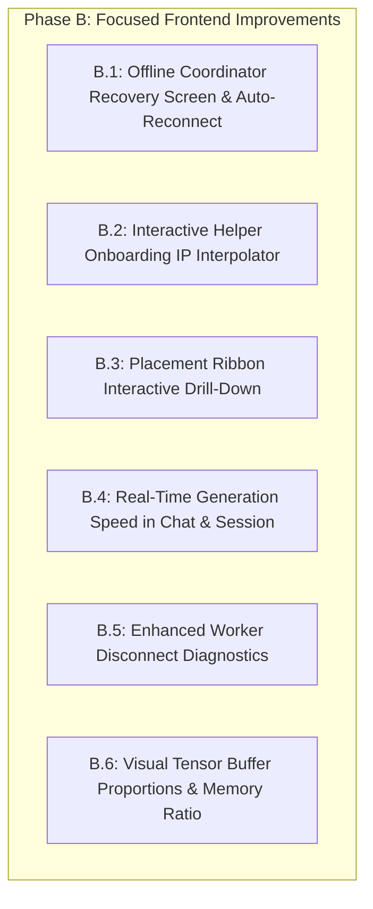

# Swarm — Phase A Acceptance Checkpoint and Phase B Planning

**Workspace:** `C:\Users\kunal\OneDrive\Desktop\swarm`  
**Date:** 2026-10-11  
**Status:** Phase A Complete · Phase B Planning Stage (Awaiting User Approval)  
**Baseline Verified:** `backups/milestone12-final-baseline-20261011/`  
**Official Model Verified:** `models/qwen2.5-3b-instruct-q4_k_m.official-check.gguf` (2,104,932,768 bytes)

---

## 1. Phase A Acceptance Checkpoint Results

### 1.1 Technical & File Integrity Check
1. **Repository & Workspace State:**
   - Workspace is an exported, standalone working tree directory (no `.git` directory present).
   - Milestone 12 baseline snapshot confirmed intact at [`backups/milestone12-final-baseline-20261011/`](file:///c:/Users/kunal/OneDrive/Desktop/swarm/backups/milestone12-final-baseline-20261011/).
   - Official check model confirmed intact at [`models/qwen2.5-3b-instruct-q4_k_m.official-check.gguf`](file:///c:/Users/kunal/OneDrive/Desktop/swarm/models/qwen2.5-3b-instruct-q4_k_m.official-check.gguf) with exact size of 2,104,932,768 bytes.
   - C++ coordinator binary (`build-cuda/swarm_node.exe`) and GGML RPC worker binary (`temp_rpc_build/bin/ggml-rpc-server.exe`) are preserved without recompilation.
2. **Frontend Build & Linter Validation:**
   - `npm run lint` (`oxlint` across 20 source files): **0 errors, 0 warnings** (executed in 102ms).
   - `npm run build` (`tsc -b && vite build`): **Succeeded in 665ms** with zero errors. Bundle output: `dist/index.html` (0.45 kB), `dist/assets/index-CV_ZtJpK.css` (19.44 kB), `dist/assets/index-w401i50c.js` (289.91 kB).
3. **Phase A Implementation Evidence & Screenshot Inventory:**
   - Historical and acceptance screenshots are archived in [`artifacts/ui_screenshots/`](file:///c:/Users/kunal/OneDrive/Desktop/swarm/artifacts/ui_screenshots/):
     - `36_phase_a_mobile_375_devices.png` — Single-column mobile devices view.
     - `37_phase_a_add_device_mode_c.png` — Remote physical helper guided workflow with security warnings.
     - `38_phase_a_add_device_mode_b.png` — Local loopback simulation modal with `Start-LoopbackRpc.ps1`.
     - `39_phase_a_desktop_1440_devices.png` — Wide desktop two-pane layout with 4-column table and right inspector.
     - `40_phase_a_desktop_1440_session.png` — Session view with contiguous layer ribbon (CPU L0–L32, RPC L33, CUDA L34–L36) and tensor buffer breakdown.
     - `41_phase_a_mobile_390_session.png` — Mobile session view with horizontally scrollable tensor buffer table.
     - `42_micropolish_320_devices.png` — Narrowest phone (320px) verification with no text collision.
     - `43_micropolish_375_devices.png` — 375px phone verification with single-line top bar and honest loopback RPC process label.
     - `44_micropolish_375_add_device_modal.png` — Inline `<HELPER_VPN_IP>` substitution guidance.
     - `45_micropolish_390_devices.png` — 390px mobile devices view.
     - `46_micropolish_390_session.png` — 390px mobile session view.
4. **Outstanding Defects:**
   - **Zero critical defects found.** The UI runs stably, handles dynamic backend polling, cleanly adapts across all tested viewports (320px, 375px, 390px, 430px, 768px, 1280px, 1440px), and respects the underlying runtime semantics.

---

## 2. Truthful Phase B Completion Matrix

An audit of the existing codebase against the original Product Design Blueprint (`docs/Swarm — Product Design and UX Blueprint.md`) and low-fidelity wireframes reveals that substantial parts of the originally planned Phase B work were **already implemented during Phase A**. 

The matrix below provides an honest accounting of each proposed feature, its existing implementation, source evidence, remaining gaps, and whether additional work is actually necessary.

| Proposed Feature | Existing Implementation Status | Evidence / Source Files | Remaining Gap | Additional Work Necessary? |
| :--- | :--- | :--- | :--- | :--- |
| **Interactive Placement Ribbon (Item B1)** | **Implemented** | [`PlacementRibbon.tsx`](file:///c:/Users/kunal/OneDrive/Desktop/swarm/ui/src/components/PlacementRibbon.tsx) | Proportional segments strictly sorted by `startLayer` ascending (L0–L32 CPU, L33 RPC, L34–L36 GPU). Hover/focus popover displays layer ranges, device name, and buffer bytes. | Clicking a ribbon segment currently does not cross-highlight the corresponding device or processor in the detailed tables. | **Yes (Minor enhancement)** — Add interactive cross-selection to link ribbon clicks to device/tensor inspect. |
| **Consolidated Devices Screen (Item B2)** | **Implemented** | [`DevicesPanel.tsx`](file:///c:/Users/kunal/OneDrive/Desktop/swarm/ui/src/components/DevicesPanel.tsx) | Merged Workers and Nodes into a single physical-first view. Loopback helper is labeled as `Local RPC process · 127.0.0.1:50052`. Desktop 2-column + mobile 1-column responsive cards. Single host RAM gauge with reserve tick. | Helper connection diagnostics (latency/ping, detailed error states if worker drops) are basic. | **Yes (Focused diagnostic polish)** — Elevate worker health diagnostics and error explanations. |
| **Session Performance & Buffer Accounting (Item B3)** | **Implemented** | [`SessionPanel.tsx`](file:///c:/Users/kunal/OneDrive/Desktop/swarm/ui/src/components/SessionPanel.tsx) | Model identity row, context window, contiguous ribbon, tensor buffer allocation table (Model Buffer, KV Cache, Compute Buffer), "Why this split?" explanation, physical memory & headroom bar. | Performance metrics currently show placeholder zeroes until a request finishes; could display live session timing stats directly. | **Yes (Focused telemetry polish)** — Surface stream timing stats (tok/s, prompt eval ms) in Session performance card. |
| **Resilient Stopped & Disconnected State (Item B4)** | **Partially Implemented** | [`useSwarmSession.ts`](file:///c:/Users/kunal/OneDrive/Desktop/swarm/ui/src/hooks/useSwarmSession.ts), [`ChatPanel.tsx`](file:///c:/Users/kunal/OneDrive/Desktop/swarm/ui/src/components/ChatPanel.tsx) | TopBar and chat indicate "Server offline" / "not_running" with warn banners when polling fails. | When coordinator crashes or stops, there is no dedicated full-page recovery screen with auto-reconnect countdown, prompt retention, or copyable restart commands. | **Yes (High value)** — Implement a dedicated coordinator offline recovery view with auto-reconnect polling. |
| **Context Meter & Streaming Cancellation (Item B5)** | **Implemented** | [`ChatPanel.tsx`](file:///c:/Users/kunal/OneDrive/Desktop/swarm/ui/src/components/ChatPanel.tsx) | Composer displays live token counter (`0 / 2048 tokens`). "Stop" button calls `abort()` on the active `AbortController`, halting the C++ decode loop via socket closure. | Composer does not display live token speed during streaming. | **Yes (Low effort)** — Show live tokens/sec in composer status footer during active generation. |
| **Session-First Navigation Architecture** | **Implemented** | [`App.tsx`](file:///c:/Users/kunal/OneDrive/Desktop/swarm/ui/src/App.tsx), [`Sidebar.tsx`](file:///c:/Users/kunal/OneDrive/Desktop/swarm/ui/src/components/Sidebar.tsx), [`TopBar.tsx`](file:///c:/Users/kunal/OneDrive/Desktop/swarm/ui/src/components/TopBar.tsx) | 4-destination navigation: Chat, Devices, Session, Settings. Top sticky Session Bar. Hash routing synchronization (`#chat`, `#devices`, `#session`, `#settings`). | None. Architecture is solid and fully responsive. | **No** — Preserve existing implementation. |
| **Memory Deduplication & Host Classification** | **Implemented** | [`useSwarmSession.ts`](file:///c:/Users/kunal/OneDrive/Desktop/swarm/ui/src/hooks/useSwarmSession.ts) | Memory deduplicated for loopback helpers; cluster subtitle accurately reports `1 physical host · 1 local RPC helper`. Low RAM condition reports memory pressure without falsely marking session broken. | None. Fully verified. | **No** — Preserve existing implementation. |
| **Manual Local & Remote Helper Guided Onboarding** | **Implemented** | [`DevicesPanel.tsx`](file:///c:/Users/kunal/OneDrive/Desktop/swarm/ui/src/components/DevicesPanel.tsx) | Two tabs: Remote Physical Helper (Mode C) with VPN security mandate and `<HELPER_VPN_IP>` guidance; Local Test Helper (Mode B) with `Start-LoopbackRpc.ps1`. | Users must manually edit the IP placeholder in their shell rather than typing it into an input box to generate the command. | **Yes (Workflow usability)** — Add an interactive IP input in the modal that auto-interpolates into the copyable commands. |

---

## 3. Prioritized Phase B Scope (Focused & Low Risk)

To maximize reliability and real-world utility without scope creep, Phase B is organized into **six focused frontend improvements**. All recommended items require **zero changes to the C++ backend** and **zero alterations to networking or security policies**.

### Item B.1: Resilient Coordinator Offline State & Auto-Reconnect Recovery
- **User Problem:** If the Swarm coordinator process terminates (e.g. killed, restarted, or crashed due to mid-decode helper disconnection), the interface currently shows generic polling errors or "Server offline" banners. The user is left wondering what happened and how to restart.
- **Proposed Solution:**
  - When `/health` polling fails for $\ge 2$ consecutive cycles, render an honest, calm "Coordinator Offline" recovery overlay/card.
  - Display the exact supported restart command based on the active mode (`.\scripts\Start-ProductionCoordinator.ps1` or `.\scripts\Start-LocalDev.ps1`) with a copy button.
  - Preserve any draft text currently in the composer.
  - Add an automatic retry countdown (e.g. "Reconnecting in 3s... [Retry now]"). Once the coordinator is back online, seamlessly restore session state without requiring a full browser refresh.
- **Dependencies:** Frontend only (`useSwarmSession.ts`, `App.tsx`).
- **Risk:** Very low. Purely reactive to polling error state.
- **Acceptance Criteria:** Terminating `swarm_node.exe` triggers the recovery screen within 3 seconds, displays the restart command, retains user input, and automatically recovers when the coordinator is restarted.

### Item B.2: Interactive Helper IP Interpolator in Add-Device Modal
- **User Problem:** Users currently copy `.\temp_rpc_build\bin\ggml-rpc-server.exe --host <HELPER_VPN_IP> ...` and must manually edit `<HELPER_VPN_IP>` in their terminal. This creates syntax errors, unescaped characters, or accidental omission of the port.
- **Proposed Solution:**
  - Add an optional "Helper VPN IP" text input field directly in the Mode C tab of the Add Device modal (with placeholder `100.80.10.2` or `10.0.0.2`).
  - As the user types their helper's VPN IP, the copyable command blocks live-update automatically.
  - If the entered address matches public/untrusted IP ranges (e.g. not `127.0.0.1`, `100.64.0.0/10`, `10.0.0.0/8`, `192.168.0.0/16`), display a gentle inline reminder: *"Private VPN mesh (WireGuard / Tailscale) required for unencrypted GGML RPC."*
- **Dependencies:** Frontend only (`DevicesPanel.tsx`).
- **Risk:** Zero. No changes to actual network connections.
- **Acceptance Criteria:** Entering an IP updates both helper worker and coordinator launcher commands live; copy buttons copy the fully resolved command.

### Item B.3: Placement Ribbon Interactive Drill-Down & Cross-Selection
- **User Problem:** The placement ribbon visualizes layer allocation clearly, but clicking a segment currently only opens a tooltip popover without linking to the detailed hardware or buffer records.
- **Proposed Solution:**
  - Make clicking a ribbon segment (e.g. clicking CUDA L34–L36 or RPC L33) navigate or jump to that device in the Devices view, or scroll and highlight that processor row in the Session tensor allocation table.
  - Enhance keyboard accessibility with visible focus rings (`focus-visible`) and Enter/Space trigger handling.
- **Dependencies:** Frontend only (`PlacementRibbon.tsx`, `SessionPanel.tsx`, `DevicesPanel.tsx`).
- **Risk:** Zero.
- **Acceptance Criteria:** Clicking a segment highlights the corresponding device/processor row; keyboard Tab + Enter focuses and selects segments.

### Item B.4: Real-Time Generation Telemetry in Chat & Session
- **User Problem:** During and after text generation, users want immediate feedback on inference speed (tokens/sec) and first-token latency without digging through log files.
- **Proposed Solution:**
  - `main.cpp` already emits stream timing data in the penultimate SSE chunk (`prompt_eval_ms`, `gen_ms`, `tokens_per_sec`).
  - In `ChatPanel.tsx`, capture these timings from the completed stream chunk and display a compact completion footer beneath assistant messages:
    *e.g. `8.2 tok/s · 142 tokens · 1.1s prompt eval`*.
  - Surface the most recent reply's speed in the Session performance summary card (`useSwarmSession.performance`).
- **Dependencies:** Frontend only (`ChatPanel.tsx`, `useSwarmSession.ts`).
- **Risk:** Very low. Uses already validated SSE chunk payload.
- **Acceptance Criteria:** Completing a chat query displays measured tokens/sec and prompt eval time beneath the message; values match backend SSE chunks.

### Item B.5: Worker Disconnect & Reachability Diagnostics
- **User Problem:** If an RPC helper becomes unreachable while the coordinator is running, the backend reports `last_error` or status changes, but the user needs clear guidance on why layers are failing and whether a restart is necessary.
- **Proposed Solution:**
  - In `DevicesPanel.tsx`, elevate worker errors from the sunken technical drawer to an actionable status alert on the device card.
  - If an RPC helper is unreachable, explain clearly:
    *"Worker unreachable. GGML does not support dynamic tensor hot-unplugging; restart coordinator or check VPN connection."*
- **Dependencies:** Frontend only (`DevicesPanel.tsx`).
- **Risk:** Zero.
- **Acceptance Criteria:** Unreachable helper devices display clear diagnostic guidance explaining that a coordinator reload/restart is required.

### Item B.6: Visual Tensor Buffer Proportions & Memory Ratio
- **User Problem:** The Tensor Buffer Allocation table in `SessionPanel.tsx` presents numeric byte counts (e.g. `1.6 GB`, `66.0 MB`, `10.0 MB`), but users cannot visually gauge the proportion of Model Weights vs KV Cache vs Compute Buffer.
- **Proposed Solution:**
  - Add a subtle stacked mini-bar beneath each processor row visually showing the ratio of Model Buffer (weights) vs KV Cache vs Compute Buffer.
  - Color-code buffers with harmonious, restrained tokens (Model = Verdigris tint, KV Cache = Brass tint, Compute = Slate tint).
- **Dependencies:** Frontend only (`SessionPanel.tsx`).
- **Risk:** Zero.
- **Acceptance Criteria:** Numeric table remains primary; visual mini-bars render accurate byte ratios without cluttering or wrapping table columns.

---

## 4. Work Intentionally Deferred (Out of Scope for Phase B)

The following architectural and platform features were identified in the Blueprint or long-term roadmap but are **explicitly excluded from Phase B**. They require separate architectural proposals, user approval, or backend C++ modifications:

| Deferred Feature | Reason for Deferral | Appropriate Future Phase |
| :--- | :--- | :--- |
| **C++ Dry-Run Placement Endpoint (`/api/v1/placement/dry-run`)** | Requires writing and exposing new C++ endpoints in `main.cpp` and `policy.h`. Phase B remains strictly frontend. | **Phase C (Backend Engineering)** |
| **Native Local Process Supervisor (`127.0.0.1:8081`)** | Browsers cannot manage native processes. Requires a standalone privileged daemon with CSRF protection and process sandboxing. | **Phase C (Backend / Daemon)** |
| **New Unified `/session` REST Endpoint** | Client-side correlation in `useSwarmSession.ts` is currently performant and reliable. Modifying C++ HTTP endpoints is deferred. | **Phase C (Backend Engineering)** |
| **Remote Pairing / Telemetry Security Alterations** | GGML RPC transport remains raw TCP; altering firewall rules or RPC bindings risks breaking verified Milestone 12 configurations. | **Phase D (Security Hardening)** |
| **IndexedDB Conversation Persistence** | In-memory session chat is sufficient for Phase B. Persistence across browser reloads requires state migration planning. | **Phase D / Later UX** |
| **Desktop Shell Packaging (Electron/Tauri), Linux Port, Android Client** | Cross-platform runtime and packaging are long-term platform deliverables. | **Phase E (Platform Evolution)** |

---

## 5. Phase B Execution Plan & Acceptance Criteria Summary

### Phase B Implementation Schedule & Status
1. **Sprint 1 (Reliability & Recovery):** Items **B.1** (Coordinator Offline Recovery Screen) and **B.5** (Worker Disconnect Diagnostics) — **ACCEPTED**.
2. **Sprint 2 (Onboarding & Interaction):** Items **B.2** (Helper IP Interpolator in Add-Device Sheet) and **B.3** (Ribbon Interactive Drill-Down) — **ACCEPTED**.
3. **Sprint 3 (Generation Performance & Tensor Visualization):** Items **B.4** (Authoritative Generation Telemetry) and **B.6** (Tensor Buffer Composition Visualization) — **ACCEPTED**.
4. **Validation:** End-to-end multi-viewport browser testing, unit tests (10/10 passing), linting (0 errors), and production build verification (`tsc -b && vite build`) passed.

---

## 6. Sprint 3 Acceptance Decision

**Sprint 3 is fully ACCEPTED.**
See [`docs/Phase B Sprint 3 Completion Report.md`](file:///c:/Users/kunal/OneDrive/Desktop/swarm/docs/Phase%20B%20Sprint%203%20Completion%20Report.md) for complete evidence reconciliation, metric consistency rules, and screenshot inventory.
