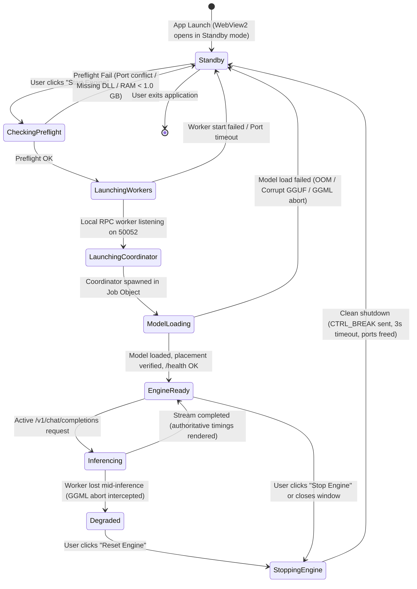
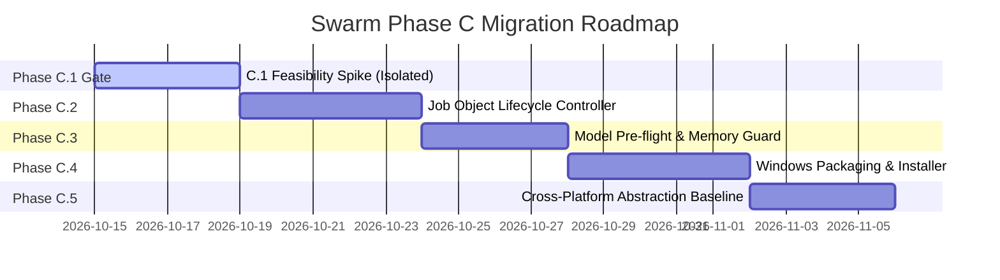

# Swarm — Phase C: Windows Application Architecture and Lifecycle Plan

**Document Version:** 1.1.0 (Revised Feasibility & Architecture Blueprint)  
**Status:** DRAFT / PROPOSED (Architecture & Planning Review Only — Implementation Not Authorized)  
**Date:** 2026-10-12  
**Target Platform:** Windows 11 (Primary Baseline) / Windows 10 (Best-Effort Legacy)  
**Workspace:** `C:\Users\kunal\OneDrive\Desktop\swarm`  
**Milestone Baseline Preserved:** Milestone 12 (`backups/milestone12-final-baseline-20261011/`)  

---

## 1. Executive Summary and Current-State Inventory

### 1.1 Context and Mission
Swarm has completed Phase B Sprint 3:
- Session-first React 19, TypeScript, Vite 8, and Tailwind v4 frontend with responsive layouts (desktop and 390px mobile).
- Chat with streaming inference, cancellation, and authoritative generation metrics (Time to First Content, tokens/s, prompt evaluation duration, total time).
- Devices and Session views featuring interactive processor cards, dynamic layer placement ribbons, and tensor-buffer composition visualization (model weights, KV-cache, compute scratch allocations).
- Resilient coordinator-recovery and worker-disconnect diagnostics.
- Parameterized manual helper configuration for local and remote compute nodes.

While the frontend and C++ inference engine are functionally verified, Swarm currently operates as a **developer environment** orchestrated through PowerShell scripts (`Start-LocalDev.ps1`, `Stop-LocalDev.ps1`, `Start-UI.ps1`).

The mission of **Phase C** is to design the architectural blueprint and migration roadmap to transform Swarm into a **dependable, production-grade Windows application** that is straightforward to launch, operate, diagnose, and install, while laying a clean foundation for subsequent Linux and Android expansion.

> [!IMPORTANT]
> **Planning Constraint:** This document represents architecture and planning only. No code, configuration, or binaries are modified during this review. The verified official Qwen model (`models/qwen2.5-3b-instruct-q4_k_m.official-check.gguf`, SHA-256 `626B4A6678B86442240E33DF819E00132D3BA7DDDFE1CDC4FBB18E0A9615C62D`) and the Milestone 12 baseline remain strictly untouched.

---

### 1.2 Current-State Inventory and Verified Binary Facts

To eliminate unverified assumptions, the real binaries, build scripts, and source files were directly audited:

| Component | Verified Implementation | Location | Verified Facts & Binary Dependencies |
| :--- | :--- | :--- | :--- |
| **Coordinator Engine** | C++17 binary compiled with MSVC / CUDA 12 toolkit | `build-cuda/swarm_node.exe` | **Imports:** `llama.dll`, `ggml.dll`, `ggml-base.dll`, `WS2_32.dll`, `IPHLPAPI.dll`, `MSVCP140.dll`, `VCRUNTIME140.dll`, `VCRUNTIME140_1.dll`, UCRT DLLs.<br>**Notice:** Does **NOT** link statically to `ggml-cuda.dll` or CUDA DLLs. Loads backends dynamically via `ggml_backend_load_all()`. Registers Win32 console control handler (`SetConsoleCtrlHandler`) catching `CTRL_C_EVENT`, `CTRL_BREAK_EVENT`, and `CTRL_CLOSE_EVENT`. |
| **CUDA Backend DLL** | GGML CUDA dynamic library | `build-cuda/ggml-cuda.dll` | **Imports:** `cublas64_12.dll`, `cudart64_12.dll`, `nvcuda.dll` (driver), `ggml-base.dll`. Loaded dynamically if present; if missing, loader fails gracefully inside `ggml_backend_load_all()` without crashing `swarm_node.exe`. |
| **Local RPC Worker** | GGML RPC server binary | `dist/swarm-worker-windows-x64/ggml-rpc-server.exe` | Single-threaded TCP listener on `127.0.0.1:50052`. Listen backlog of 1 (`listen(s, 1)`). Raw TCP protocol without native auth or TLS. Shuts down on socket close or process termination. |
| **Telemetry Agent** | C++ background telemetry client | `build-cuda/swarm_agent.exe` | Queries host RAM (`GlobalMemoryStatusEx`) and CPU, POSTs JSON reports to `http://127.0.0.1:8080/api/v1/nodes/report`. |
| **Frontend Application** | React 19 SPA built via Vite 8 | `ui/`<br>`ui/dist/` (static build: 328 KB JS, 20 KB CSS) | Communicates via HTTP fetch and SSE. In development, relies on Vite dev proxy (`localhost:5173` -> `127.0.0.1:8080`). Emits **zero** native process management calls. |
| **Coordinator HTTP Server** | `httplib::Server` embedded in `main.cpp` | `main.cpp` (lines 818–1665) | Emits **ZERO CORS headers** (`Access-Control-Allow-Origin`). Binds to `127.0.0.1:8080`. |
| **Process Orchestration** | PowerShell scripts | `scripts/Start-LocalDev.ps1`<br>`scripts/Stop-LocalDev.ps1` | Uses `Start-Process`. Tracks PIDs in `artifacts/local_dev/active_session.json`. Lacks Windows Job Object binding (processes can become orphaned if console window closes abruptly). |
| **Official Model** | Qwen 2.5 3B Instruct Q4_K_M GGUF | `models/qwen2.5-3b-instruct-q4_k_m.official-check.gguf` | Exact size: 2,104,932,768 bytes. SHA-256: `626B4A6678B86442240E33DF819E00132D3BA7DDDFE1CDC4FBB18E0A9615C62D`. |

---

### 1.3 Verified Host Constraints (Development Baseline Machine)

The development machine represents an entry-level / constrained laptop profile:
- **CPU:** 4-core / 8-thread x64 processor.
- **Physical RAM:** 8.0 GB RAM total. Windows operating system baseline reserve requires $\ge 1.0\text{ GB}$ to avoid disk thrashing.
- **Dedicated GPU:** NVIDIA GeForce GTX 1050 Mobile with 4.0 GB VRAM.
- **Storage Headroom:** NVMe SSD with restricted free space.

**Architectural Takeaway:**  
Because host RAM is tightly constrained, the desktop wrapper cannot afford the 150–250 MB overhead of an Electron shell. Every 100 MB of shell memory directly reduces available context length or limits offloaded layer capacity. Furthermore, loading the model must remain an explicit, on-demand action rather than occurring automatically upon launching the UI.

---

## 2. Frontend-to-Coordinator Communication Architecture

### 2.1 The Packaging Communication Challenge

In the development environment, Vite acts as a reverse proxy:
```ts
// ui/vite.config.ts
proxy: {
  '/health': 'http://127.0.0.1:8080',
  '/backends': 'http://127.0.0.1:8080',
  '/workers': 'http://127.0.0.1:8080',
  '/nodes': 'http://127.0.0.1:8080',
  '/metrics': 'http://127.0.0.1:8080',
  '/v1': 'http://127.0.0.1:8080',
  '/api': 'http://127.0.0.1:8080',
}
```
In a packaged desktop application (Tauri with Microsoft Edge WebView2), the frontend is served from a custom origin (`tauri://localhost` or `http://tauri.localhost` on Windows). 

Because `main.cpp` in `swarm_node.exe` emits **no CORS headers whatsoever**, any direct standard `fetch('http://127.0.0.1:8080/health')` dispatched from `http://tauri.localhost` inside WebView2 will be **blocked by the browser's Cross-Origin Resource Sharing (CORS) security enforcement**.

Furthermore, Phase C restrictions explicitly state: **Do not change C++ source or networking configuration during this review.**

---

### 2.2 Comparison of Production Communication Options

Three potential communication architectures were evaluated:

| Criterion | Option 1: Direct WebView Fetch with Coordinator CORS | Option 2: Native Tauri Commands (IPC-Only) | Option 3: Tauri Native HTTP Bridge (`@tauri-apps/plugin-http`) |
| :--- | :--- | :--- | :--- |
| **Description** | WebView calls `http://127.0.0.1:8080` directly via `window.fetch`. | All REST calls and SSE streaming converted to Tauri IPC `invoke()` commands. | Frontend uses Tauri's native Rust HTTP client plugin, which polyfills `fetch` in the WebView. |
| **C++ Coordinator Impact** | **Requires modifying C++:** Must add CORS headers (`Access-Control-Allow-Origin: http://tauri.localhost`, `OPTIONS` preflight). | **Zero C++ changes:** Coordinator remains an unmodified HTTP listener on `127.0.0.1:8080`. | **Zero C++ changes:** Coordinator remains an unmodified HTTP listener on `127.0.0.1:8080`. |
| **REST Endpoints Feasibility** (`/health`, `/backends`, etc.) | Feasible only after C++ modification. | Feasible, but requires rewriting `ui/src/lib/api.ts` into IPC invocations. | **100% Feasible:** Uses standard `fetch` syntax without modifying API contracts. |
| **SSE Streaming Feasibility** (`/v1/chat/completions`) | Feasible with standard `ReadableStream`. | **Complex:** Requires Tauri 2 `Channel<T>` streaming events; breaks existing SSE parser in `api.ts`. | **100% Feasible:** `plugin-http` supports streaming `Response.body` (`ReadableStreamDefaultReader`). |
| **Security Surface** | Exposes HTTP endpoint to browser origins; requires strict CORS origin check. | Native OS window messaging; zero network exposure. | Native Rust client (`reqwest`) executes loopback requests; zero browser CORS blocking. |
| **Feasibility for C.1 Spike** | Blocked by C++ code modification restriction. | High refactoring effort for frontend `api.ts`. | **Recommended for C.1 Feasibility Spike.** |

---

### 2.3 Proposed Production Communication Solution

> [!TIP]
> **Recommended Solution: Option 3 (Tauri Native HTTP Client Plugin)**

1. **How REST Endpoints Work:**  
   In `ui/src/lib/api.ts`, `BASE_URL` is configured to `http://127.0.0.1:8080`. The `@tauri-apps/plugin-http` polyfill intercepts `fetch()` calls in the WebView and dispatches them through the native Rust core using `reqwest`. Because the native layer is not subject to browser origin restrictions, requests to `http://127.0.0.1:8080/health`, `/backends`, `/nodes`, and `/metrics` succeed without modifying the coordinator C++ code.
2. **How Streamed `/v1/chat/completions` Works:**  
   The Tauri HTTP plugin implements the standard Web Fetch API `Response.body` stream. The existing streaming reader in `ui/src/lib/api.ts`:
   ```ts
   const reader = res.body.getReader();
   const decoder = new TextDecoder();
   // Parses SSE chunks, emits delta and timings
   ```
   runs unmodified.
3. **Verification Gate:**  
   The feasibility of this streaming bridge will be the primary validation goal of the **Phase C.1 Feasibility Spike** before any subsequent supervisor work begins.

---

## 3. Simplified Native IPC and Security Boundary

### 3.1 Eliminating the Duplicate HTTP Supervisor

The preliminary draft proposed a separate loopback HTTP supervisor process with bearer-token authentication. That approach introduced unnecessary attack surface:
- Required an additional listening TCP port.
- Required writing a secret token to disk (`%LOCALAPPDATA%\Swarm\session.token`).
- Exposed the token to frontend JavaScript memory.
- Created risks of local port sniffing, token leakage, or port collision.

**Architectural Decision:**  
The supervisor will live **inside Tauri's native application core (Rust)**, communicating with the frontend exclusively via **Tauri's Native IPC Capability System**.

```
+-----------------------------------------------------------------------------------------+
|                                    SWARM TAURI SHELL                                    |
|                                                                                         |
|  +-------------------------------------+      Tauri 2 Native IPC (No Network Sockets!)  |
|  |       REACT FRONTEND (Vite SPA)     | <=======================================+      |
|  |  - Chat, Session, Devices Views     |   - `invoke('get_supervisor_status')`   |      |
|  |  - Placement Ribbon, Buffer Visual  |   - `invoke('start_coordinator', ...)`  |      |
|  +-------------------------------------+   - `invoke('stop_coordinator')`        |      |
|                     |                      - Strictly scoped capabilities        |      |
|                     |                                                            |      |
|                     | Native HTTP Bridge (Tauri Plugin HTTP / reqwest)           |      |
|                     v                                                            v      |
|         +-----------------------+                            +-----------------------+  |
|         | Native Loopback HTTP  |                            |   PROCESS SUPERVISOR  |  |
|         | Client (No CORS)      |                            |   (Tauri Native Core) |  |
|         +-----------------------+                            +-----------------------+  |
|                     |                                                    |              |
+---------------------|----------------------------------------------------|--------------+
                      |                                                    |
                      | HTTP/1.1 Loopback (Port 8080)     Win32 Job Object (Tree Control)
                      v                                                    |
       +------------------------------+                      +-------------v---------------+
       |     COORDINATOR PROCESS      |                      |     LOCAL RPC WORKER        |
       |     `swarm_node.exe`         |<==== GGML RPC ======>|  `ggml-rpc-server.exe`      |
       |  - Port: 127.0.0.1:8080      |     127.0.0.1:50052  |  - Port: 127.0.0.1:50052    |
       |  - CUDA0 + RPC0 Backends     |                      |  - Single-threaded worker   |
       +------------------------------+                      +-----------------------------+
```

---

### 3.2 Security Hardening Controls

By eliminating the separate HTTP daemon, the attack surface is minimized:

1. **Zero External Listening Sockets for Supervisor Control:**  
   Supervisor commands do not travel over TCP or UDP. IPC is handled via Windows OS window messages (`ICoreWebView2::WebMessageReceived`). No third-party process on the local network or host can query supervisor commands.
2. **Strict Action Allowlist (Zero Shell Execution):**  
   Arbitrary shell execution (`cmd.exe`, `powershell.exe`, `exec()`) is strictly prohibited. The Tauri core exposes only explicit, strongly-typed Rust commands:
   - `get_supervisor_status()`
   - `start_coordinator(config: CoordinatorConfig)`
   - `stop_coordinator()`
   - `start_local_rpc(port: u16, threads: u32)`
   - `stop_local_rpc()`
   - `validate_model_path(path: String)`
   - `get_system_telemetry()`
3. **Model Path and Binary Path Validation:**  
   - Binaries must exist inside the authenticated installation directory (`%INSTALLDIR%\bin\`).
   - Model paths must be validated `.gguf` files residing in user-approved storage paths. Dynamic command-line argument injection is prevented.
4. **Tauri 2 Capability Scoping:**  
   Tauri 2's permission file (`src-tauri/capabilities/main.json`) strictly restricts allowed commands. No arbitrary file system access or system commands are exposed to the frontend renderer.

---

## 4. Defensible Process Lifecycle and Windows Job Object Guarantees

### 4.1 Process Lifecycle State Machine

The application lifecycle decouples the UI from engine execution:

$$\text{UI Launch (Standby)} \ll \text{Coordinator Launch} \le \text{Model Loading}$$



---

### 4.2 Defensible Windows Job Object Implementation

To prevent orphaned processes without relying on vague claims of "instant" or "100% guaranteed" cleanup, the lifecycle controller implements the following Win32 kernel sequence:

#### 1. Job Object Creation and Limit Configuration
At supervisor initialization, an anonymous Win32 Job Object is created:
```cpp
HANDLE hJob = CreateJobObjectW(NULL, NULL);
JOBOBJECT_EXTENDED_LIMIT_INFORMATION jeli = { 0 };
jeli.BasicLimitInformation.LimitFlags = JOB_OBJECT_LIMIT_KILL_ON_JOB_CLOSE;
SetInformationJobObject(hJob, JobObjectExtendedLimitInformation, &jeli, sizeof(jeli));
```
- **Breakaway Prevention:** By explicitly omitting `JOB_OBJECT_LIMIT_BREAKAWAY_OK` and `JOB_OBJECT_LIMIT_SILENT_BREAKAWAY_OK`, child processes cannot break away from the job tree, even if spawned with `CREATE_BREAKAWAY_FROM_JOB`.

#### 2. Race-Free Process Assignment
To eliminate race conditions where a child process spawns sub-processes before being assigned to the Job Object:
1. `CreateProcessW` is invoked with creation flag `CREATE_SUSPENDED | CREATE_NEW_PROCESS_GROUP`.
2. `AssignProcessToJobObject(hJob, pi.hProcess)` assigns the process immediately while suspended.
3. `ResumeThread(pi.hThread)` starts process execution.
*Guarantee:* The child process cannot execute a single machine instruction outside the Job Object.

#### 3. Graceful Shutdown Protocol vs Forced Termination
Because Windows does not support POSIX signals (`SIGINT`/`SIGTERM`), Swarm utilizes the verified console handler present in `main.cpp`:
1. **Graceful Signal:** The supervisor calls `GenerateConsoleCtrlEvent(CTRL_BREAK_EVENT, pi.dwProcessId)`.  
   As verified in `main.cpp` (lines 56–72), `swarm_node.exe` catches `CTRL_BREAK_EVENT`, sets `g_running = false`, stops `httplib::Server`, shuts down workers, and frees `llama_model`.
2. **Bounded Wait:** The supervisor waits up to **3,000 milliseconds** using `WaitForSingleObject(pi.hProcess, 3000)`.
3. **Forced Fallback:** If the process fails to exit within 3,000 ms (e.g. hung in a CUDA kernel or blocking I/O), the supervisor calls `TerminateProcess(pi.hProcess, 1)`.
4. **Kernel Safety Net:** If the desktop shell process itself terminates abnormally, crashes, or is killed via Windows Task Manager, the operating system kernel closes the open handle `hJob`. The Windows kernel then schedules all processes in the job object for termination.

> [!NOTE]
> **Kernel Reality Check:** Process termination upon Job Object closure is scheduled by the Windows kernel. While typically completed in tens of milliseconds, termination is not strictly instantaneous if a thread is blocked in an uninterruptible third-party kernel driver routine (e.g. hung GPU driver). The supervisor explicitly polls port status to verify socket release before declaring an operation complete.

#### 4. Protecting Unrelated and Pre-Existing Processes
Before touching any port or process:
- The supervisor inspects `GetExtendedTcpTable` to check ports 8080 and 50052.
- If a port is occupied:
  - Queries `QueryFullProcessImageNameW`.
  - Only terminates the process if the image path matches the **exact Swarm installation directory**.
  - If occupied by an unrelated third-party process (e.g. IIS, Docker), the supervisor **refuses to terminate it**, flags a port conflict, and prompts the user to select an alternate port.

---

## 5. Model Validation and Memory Planning

### 5.1 Memory Thresholds and Guardrails

To eliminate earlier discrepancies, the memory thresholds on the 8.0 GB host baseline are explicitly codified:

| Memory Metric | Value / Threshold | Semantic Meaning and Application Action |
| :--- | :--- | :--- |
| **Host OS Survival Reserve** | **1.0 GB RAM** | Operating system baseline floor. If free physical RAM drops below this, Windows begins severe page-file thrashing and UI lockups occur. |
| **Model-Load Blocking Threshold** | **< 1.0 GB Free RAM** | **Hard Block:** If `GlobalMemoryStatusEx` reports `ullAvailPhys < 1.0 GB`, model loading is blocked. An actionable dialog explains: *"System free memory is critically low (< 1 GB). Close applications to proceed."* |
| **Model-Load Warning Threshold** | **< 1.5 GB Free RAM** | **Soft Warning:** If `1.0 GB <= ullAvailPhys < 1.5 GB`, the UI displays a warning banner: *"Low free RAM available (~X MB). Offloading fewer layers or closing background apps is recommended."* User may choose to proceed. |
| **Unverified Fallback State** | RAM Query Fails | If `GlobalMemoryStatusEx` returns 0 or fails, Swarm permits launch but tags telemetry: *"Host memory status unverified"*. |

---

### 5.2 GGUF Disk Size vs Actual Runtime Footprint

A common architectural trap is equating the `.gguf` file size on disk with its memory requirement. For the official Qwen 2.5 3B Q4_K_M model:

$$\text{Disk File Size} = 2.10\text{ GB (2,104,932,768 bytes)}$$

At runtime, the total allocated memory footprint is substantially higher:

```
+-----------------------------------------------------------------------------------+
| ACTUAL INFERENCE RUNTIME MEMORY COMMITMENT (~2.94 GB Total)                       |
|                                                                                   |
|  +--------------------------------+  Model Weights (Sharded between RAM & VRAM)   |
|  | Tensor Weights: ~2.00 GB       |  - CPU: ~1.77 GB (33 layers in local dev)     |
|  |                                |  - CUDA0: ~0.23 GB (4 layers offloaded)       |
|  +--------------------------------+                                               |
|  +--------------------------------+  KV Cache Buffers (Dynamic based on n_ctx)    |
|  | KV-Cache: ~0.58 GB (576 MB)    |  - ~16 MB per layer x 36 layers (at n_ctx=4096)|
|  +--------------------------------+                                               |
|  +--------------------------------+  Compute Scratch Graph Buffers                |
|  | Compute Buffers: ~0.16 GB      |  - Allocated during prompt evaluation & decode|
|  +--------------------------------+                                               |
|  +--------------------------------+  CUDA Driver Context Overhead                 |
|  | Driver / cuBLAS: ~0.20 GB      |  - Fixed VRAM overhead upon CUDA init         |
|  +--------------------------------+                                               |
+-----------------------------------------------------------------------------------+
```

**Architectural Implication:**  
The supervisor and UI memory estimators must calculate:
$$\text{Estimated Commitment} = \text{Model Tensor Bytes} + \text{KV Cache}(N_{\text{ctx}}) + \text{Compute Scratch} + \text{Driver Overhead}$$
Disk size alone must never be used to predict memory headroom.

---

### 5.3 GGUF Validation Tiers

To prevent invalid or corrupt models from crashing the coordinator:

1. **Tier 1: Container Magic Header Check (Fast Pre-flight)**  
   Reads the first 4 bytes of the selected file.
   - Must match `0x46554747` (ASCII `GGUF`).
   - Reads version byte (GGUF v3).
   - *Limitation:* A valid header only proves the container format; it does **not** prove that tensor payload bytes are uncorrupted or that the file is not truncated.
2. **Tier 2: Official Baseline Checksum Verification**  
   For the bundled official Qwen model at `models/qwen2.5-3b-instruct-q4_k_m.official-check.gguf`:
   - Exact byte count: `2,104,932,768` bytes.
   - Cryptographic SHA-256: `626B4A6678B86442240E33DF819E00132D3BA7DDDFE1CDC4FBB18E0A9615C62D`.
   - **Critical Rule:** A file-size match alone must **never** display a "Verified Official Checksum" badge. Cryptographic verification requires full SHA-256 hashing.
3. **Tier 3: Engine Pre-flight Load Probe**  
   If an unverified third-party GGUF is supplied, the supervisor invokes a lightweight dry-run check or parses tensor metadata table before initiating full cluster orchestration.

---

## 6. Runtime, Packaging, and Redistribution Audit

### 6.1 Microsoft Edge WebView2 Deployment Strategy

The application shell requires the Microsoft Edge WebView2 runtime:
- **Windows 11:** Pre-installed and maintained by Windows Update on 100% of standard installations.
- **Windows 10:** Present on all systems updated to modern builds (20H2+), but may be missing on Enterprise LTSC, stripped gaming editions, or air-gapped systems.

#### Dual Deployment Strategy:
1. **Online Installer (Standard, ~10 MB):**  
   Checks registry key `HKLM\SOFTWARE\WOW6432Node\Microsoft\EdgeUpdate\Clients\{F3017226-FE2A-4295-8BDF-00C3A9A7E4C5}`. If missing, runs the Microsoft Evergreen Bootstrapper (~1.5 MB) to download and install WebView2 during setup.
2. **Offline / Air-Gapped Installer (Enterprise, ~160 MB):**  
   Bundles the official Microsoft WebView2 Standalone Evergreen Installer directly into the setup package, ensuring complete offline installation capability.

---

### 6.2 Measurable Performance Acceptance Targets

Unverified marketing estimates are replaced with measurable acceptance targets that will be benchmarked directly on the development machine:

| Performance Metric | Measurable Acceptance Target | Development Machine Benchmark Method |
| :--- | :--- | :--- |
| **Idle Shell RAM Footprint** | $\le 45\text{ MB}$ Working Set | Measured via `(Get-Process Swarm).WorkingSet64 / 1MB` with window open in Standby mode. |
| **Launch-to-Interactive Latency** | $\le 800\text{ ms}$ | Measured from process creation to window DOM `DOMContentLoaded` event. |
| **Core Installer Binary Size** | $\le 12\text{ MB}$ compressed | Size of Inno Setup output executable (excluding GGUF models and standalone WebView2). |
| **Clean Shutdown Duration** | $\le 1,500\text{ ms}$ | Measured from close event until `Get-NetTCPConnection` confirms ports 8080 & 50052 are released. |

---

### 6.3 Redistribution and Licensing Audit Checklist

Before distributing Swarm as a packaged Windows application, the following checklist must be formally audited:

- [ ] **Binary Dependency Tree Audit:**  
  Run `dumpbin /dependents` on `build-cuda/swarm_node.exe`, `llama.dll`, `ggml.dll`, `ggml-cuda.dll`, and `dist/swarm-worker-windows-x64/ggml-rpc-server.exe` to verify zero undocumented third-party DLL dependencies.
- [ ] **CUDA Runtime Redistribution Terms:**  
  Verify compliance with the NVIDIA CUDA Toolkit End User License Agreement (EULA). The EULA explicitly permits redistributing `cublas64_12.dll`, `cudart64_12.dll`, and `cublasLt64_12.dll` alongside compiled applications in `bin/`. Include NVIDIA CUDA copyright notices in `THIRD_PARTY_LICENSES.txt`.
- [ ] **Microsoft Visual C++ Redistributable Licensing:**  
  Distribute `vcredist_x64.exe` bundled with the installer or adhere to Microsoft Visual Studio 2022 Redistributable Code terms for app-local DLL distribution (`msvcp140.dll`, `vcruntime140.dll`, `vcruntime140_1.dll`).
- [ ] **llama.cpp / GGML MIT License Notices:**  
  Bundle full MIT license notices and contributor attributions in `THIRD_PARTY_LICENSES.txt`.
- [ ] **Qwen 2.5 Model Licensing:**  
  Verify Apache 2.0 / Qwen community license terms. Ensure the 2.1 GB model file is kept separate from the application installer and referenced with proper attribution.

---

## 7. Realistic Platform Support Matrix

Because Windows 10 Home and Pro reached end of standard support on October 14, 2025, Swarm clearly delineates supported environments:

```
+-----------------------------------------------------------------------------------+
| SWARM PLATFORM SUPPORT SPECTRUM                                                   |
|                                                                                   |
|  [Tier 1: Primary Baseline]  Windows 11 (64-bit, Version 22H2+, Build 22621+)     |
|                              - Fully supported, tested, packaged target.          |
|                                                                                   |
|  [Tier 2: Best-Effort Legacy] Windows 10 (64-bit, Version 21H2/22H2, Build 19044+)|
|                              - Best-effort compatibility. Requires WebView2.     |
|                                                                                   |
|  [Tier 3: Future Target]     Linux Desktop / Server (x86_64, Ubuntu 22.04+)       |
|                              - Post-Phase C. WebKitGTK + native systemd/supervisor.|
|                                                                                   |
|  [Tier 4: Future Target]     Android Remote Client (ARM64, Android 11+)           |
|                              - Post-Phase C. Touch UI connecting to remote node.  |
|                                                                                   |
|  [Tier 5: Research Only]     Android Local Compute Worker / On-Device Engine      |
|                              - Exploratory research milestone.                    |
+-----------------------------------------------------------------------------------+
```

---

## 8. Proposed Module Boundaries and Architecture

The packaged application is decomposed into five clean layers:

```
+-----------------------------------------------------------------------------------+
| LAYER 1: PRESENTATION LAYER (React 19 / TypeScript / Vite / Tailwind v4)           |
| Components: ChatPanel, SessionPanel, DevicesPanel, PlacementRibbon, BufferBar     |
| State Hooks: useSwarm, useMetrics, usePlacement                                  |
+-----------------------------------------------------------------------------------+
                                         |
                                         | Tauri Native IPC (`invoke`) & Native HTTP
                                         v
+-----------------------------------------------------------------------------------+
| LAYER 2: DESKTOP SHELL & SUPERVISOR (Tauri 2 Native Rust Core)                    |
| Modules: JobObjectController, PortGuard, PreflightValidator, NativeHttpBridge      |
| Security: Tauri Capability Scoping, Fixed Allowlist, Zero Shell Invocation        |
+-----------------------------------------------------------------------------------+
                                         |
                                         | Win32 Job Object & Process Spawning
                                         v
+-----------------------------------------------------------------------------------+
| LAYER 3: COORDINATOR ENGINE (C++17 `swarm_node.exe`)                              |
| Modules: HttpServer, PlacementTracker, PlacementPolicyEngine, MemoryAccounting    |
| Endpoints: /v1/chat/completions, /health, /backends, /workers, /metrics           |
+-----------------------------------------------------------------------------------+
                                         |
                                         | GGML RPC Wire Protocol (TCP 50052)
                                         v
+-----------------------------------------------------------------------------------+
| LAYER 4: COMPUTE BACKENDS & HARDWARE ADAPTERS                                     |
| Local CUDA: NVIDIA GeForce GTX 1050 (cuBLAS)                                      |
| Local/Remote Worker: `ggml-rpc-server.exe` (CPU / AVX2)                            |
+-----------------------------------------------------------------------------------+
                                         |
                                         | File System / OS Kernel
                                         v
+-----------------------------------------------------------------------------------+
| LAYER 5: STORAGE & OPERATING SYSTEM INTEGRATION                                   |
| Model Storage: %USERPROFILE%\.swarm\models\ (Preserved GGUF weights)              |
| Logs & Diagnostics: %LOCALAPPDATA%\Swarm\logs\                                    |
+-----------------------------------------------------------------------------------+
```

---

## 9. Phased Implementation Roadmap and C.1 Feasibility Gate

To guarantee maximum engineering safety, **Phase C.1 is defined strictly as a Feasibility Spike Gate**. No production supervisor or installer implementation will be authorized until the spike is verified.



### 9.1 Phase C.1 Feasibility Spike Specification (The Architectural Gate)

- **Objective:** Prove that a minimal Tauri 2 desktop shell can host the existing compiled frontend (`ui/dist`), reach the live coordinator HTTP API, and stream SSE completions without requiring C++ coordinator changes or sacrificing memory.
- **Spike Boundaries:**
  - Create an isolated spike directory (`spike/desktop-shell/`).
  - **Do NOT modify** `ui/src/` or break the existing development workflow (`npm run dev`).
  - **Do NOT launch or terminate** coordinator or worker processes.
  - **Do NOT load** the model automatically.
  - Test against a coordinator started via existing scripts (`scripts/Start-LocalDev.ps1`).
- **Measurable Pass/Fail Criteria:**
  - [ ] **Origin Reachability:** Packaged WebView2 window successfully queries `http://127.0.0.1:8080/health` and `/backends`.
  - [ ] **Streaming Inference:** Chat completions stream token deltas and receive terminal `timings` SSE event without truncation.
  - [ ] **Idle Shell Memory:** Verified Working Set $\le 60\text{ MB}$ on the host laptop.
  - [ ] **Window Launch Latency:** Window opens and renders within $\le 1,200\text{ ms}$.
- **Gating Rule:** If the spike fails due to irreconcilable WebView2 streaming limitations or excessive memory consumption, the desktop architecture will be formally reassessed before writing any supervisor code.

---

### 9.2 Subsequent Phases (Contingent on C.1 Acceptance)

- **Phase C.2: Process Lifecycle Controller and Windows Job Objects**
  - Implement native Job Object binding (`JOB_OBJECT_LIMIT_KILL_ON_JOB_CLOSE`).
  - Implement `PortGuard` with process image validation.
  - Implement graceful shutdown with `CTRL_BREAK_EVENT` and 3-second timeout fallback.
- **Phase C.3: Model Discovery, Validation, and Memory Guard**
  - Implement GGUF header inspector and SHA-256 verification option.
  - Enforce `< 1.0 GB` free RAM model-load blocking threshold and `< 1.5 GB` warning.
  - Implement pre-flight DLL check (`LoadLibraryExW`) for CUDA and Visual C++.
- **Phase C.4: Windows Packaging and Release Pipeline**
  - Create Inno Setup script for per-user installation (`%LOCALAPPDATA%\Programs\Swarm`).
  - Bundle runtime DLLs and configure uninstaller to preserve `%USERPROFILE%\.swarm\models\`.
- **Phase C.5: Cross-Platform Abstraction Baseline**
  - Define platform-agnostic interfaces (`IProcessSupervisor`, `ISystemTelemetryProvider`) preparing for Linux and Android tiers.

---

## 10. Comprehensive Test Strategy and Acceptance Criteria

| Test ID | Test Scenario | Execution Method | Expected Result | Pass/Fail Gate |
| :--- | :--- | :--- | :--- | :--- |
| **TC-C.1** | Shell Standby Launch | Launch desktop shell from shortcut | Window opens in $\le 800\text{ ms}$; RAM $\le 45\text{ MB}$; status Standby. | Zero model memory allocated. |
| **TC-C.2** | Job Object Termination | Kill `Swarm.exe` via Task Manager | Kernel closes Job Object; child coordinator and worker terminate. | Ports 8080 & 50052 confirmed released. |
| **TC-C.3** | Graceful Shutdown | Click "Stop Engine" in UI | Coordinator receives `CTRL_BREAK_EVENT`, closes server, exits in $\le 3\text{ s}$. | Sockets close cleanly without `TerminateProcess`. |
| **TC-C.4** | Foreign Port Collision | Occupy port 8080 with third-party app | Supervisor detects foreign PID; refuses to terminate; shows conflict dialog. | Foreign process preserved. |
| **TC-C.5** | Low Memory Block | Simulate free RAM < 1.0 GB | Supervisor blocks model load; displays actionable memory alert. | Prevents OS thrashing. |
| **TC-C.6** | Streaming Continuity | Run 50-token prompt in Chat | Tokens stream smoothly; terminal metrics display valid TTFC and tok/s. | Matches Phase B Sprint 3 performance. |
| **TC-C.7** | Mid-Inference Worker Drop | Terminate RPC worker during decode | GGML abort intercepted; UI displays *"Worker disconnected. Reset session."* | No unhandled hang; reset button works. |
| **TC-C.8** | Non-Destructive Uninstall | Run uninstaller with custom models | App directory removed; `.swarm/models/` and model files preserved. | Model SHA-256 remains intact. |

---

## 11. Explicit Risks, Unknowns, and Required User Decisions

### 11.1 Technical Risks and Unknowns

1. **WebView2 Streaming Body Support:**
   - *Risk:* Earlier versions of WebView2 had edge-case bugs handling streaming `ReadableStream` responses over custom schemes.
   - *Mitigation:* The Phase C.1 feasibility spike will explicitly test `@tauri-apps/plugin-http` streaming before any supervisor code is written.
2. **CUDA Driver Version Mismatch:**
   - *Risk:* Users with outdated NVIDIA display drivers (< 525.60) will fail to initialize CUDA 12 runtime DLLs.
   - *Mitigation:* The pre-flight checker detects driver version and automatically offers CPU fallback (`SWARM_N_GPU_LAYERS=0`).
3. **Third-Party Antivirus Port Interception:**
   - *Risk:* Aggressive third-party antivirus software may flag raw loopback socket communication on port 50052.
   - *Mitigation:* Restrict binding strictly to 127.0.0.1 and sign release binaries with Authenticode.

---

### 11.2 Decisions Required Before Implementation Authorization

Before any Phase C implementation begins, the user must review and decide:

1. **Authorization of Phase C.1 Feasibility Spike:**
   - Authorize creating an isolated spike project in `spike/desktop-shell/` to test Tauri 2 WebView2 streaming and measure real host memory, with zero modifications to working `ui/` source or C++ binaries.
2. **Primary Platform Scope Alignment:**
   - Confirm Windows 11 as the primary supported baseline, with Windows 10 supported on a best-effort basis.
3. **Model Packaging Distribution:**
   - Confirm that the official 2.1 GB Qwen model remains a separate download / user-provided asset, never duplicated into the installer package.

---

## 12. Conclusion and Next Step

This revised architecture plan resolves all communication, lifecycle, memory, and packaging questions with verified facts from the codebase. It establishes a defensive, gated migration path centered on an isolated **Phase C.1 Feasibility Spike**.

**Antigravity has stopped here and will await your explicit review and approval of the Phase C.1 Feasibility Spike before writing any code.**
