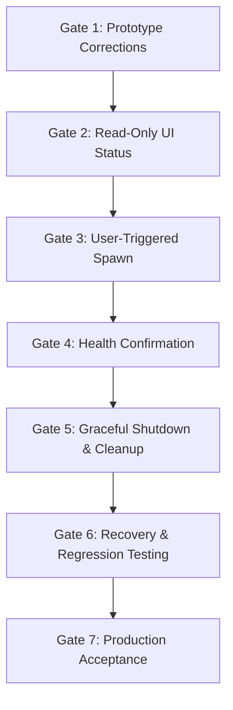

# Swarm — Phase C.2.1 Supervisor Production-Integration Readiness Audit

**Author:** Antigravity AI Pair Programmer  
**Date:** October 12, 2026  
**Status:** **AUDIT COMPLETE — READY WITH IDENTIFIED LIMITATIONS**  
**Audit Scope:** Inspection & Verification of `spike/desktop-shell/src-tauri/src/supervisor/` vs Actual Swarm Runtime  
**Reference Document:** `docs/Phase C Windows Application Architecture Plan.md`  

---

## Executive Summary

Phase C.2 delivered an isolated native process supervisor prototype under `spike/desktop-shell/`, passing nine automated test scenarios with harmless test child processes (`test_child.exe`).

This audit (Phase C.2.1) performs a rigorous inspection of that prototype against the real Swarm runtime requirements, the official deployment scripts (`Start-LocalDev.ps1`, `Stop-LocalDev.ps1`, `Start-ProductionCoordinator.ps1`, `Start-LoopbackRpc.ps1`), and the security posture of the Tauri desktop shell.

### Verdict: **READY WITH IDENTIFIED LIMITATIONS**

The core kernel mechanics of the prototype—specifically **race-free suspended creation (`CREATE_SUSPENDED`)**, **mandatory Win32 Job Object containment (`JOB_OBJECT_LIMIT_KILL_ON_JOB_CLOSE`)**, **precise process ownership**, **non-destructive port checking**, and **console control event shutdown**—are sound and verified by automated tests.

However, **direct production execution cannot be authorized yet** because four operational discrepancies and configuration gaps must be addressed before connecting the supervisor to the actual `swarm_node.exe` and `ggml-rpc-server.exe` binaries:
1. **DLL Search Path Injection (`PATH`):** `swarm_node.exe` requires runtime CUDA and GGML DLLs in `build-cuda\` and `build-cuda\bin\`. The prototype's environment block currently lacks automated `PATH` prepending, which would cause an immediate `STATUS_DLL_NOT_FOUND` (0xC0000135) crash.
2. **Hidden Console Window Configuration:** While `AttachConsole` + `GenerateConsoleCtrlEvent` was validated on `test_child.exe`, creating real children with `CREATE_NEW_CONSOLE` without `STARTF_USESHOWWINDOW` + `SW_HIDE` would pop up unwanted Win32 console windows on the user's desktop.
3. **Sequential Staged Startup State Machine:** The supervisor currently exposes atomic `spawn_child` calls, but lacks the coordinated multi-process startup sequence (Worker -> TCP readiness poll -> Coordinator -> HTTP `/health` readiness poll) implemented in `Start-LocalDev.ps1`.
4. **Environment Case-Sensitivity on Windows:** Rust's `HashMap` environment collation in `process.rs` does not normalize case-insensitive Windows environment keys (e.g., `Path` vs `PATH`).

---

## 1. Prototype Implementation Audit

The prototype source code under `spike/desktop-shell/src-tauri/src/supervisor/` was inspected line-by-line.

### 1.1 Win32 FFI & Data Structures (`win32.rs`)
- **FFI Bindings:** Validated against Microsoft Windows SDK 10.0.26100. Functions (`CreateJobObjectW`, `SetInformationJobObject`, `AssignProcessToJobObject`, `CreateProcessW`, `ResumeThread`, `TerminateProcess`, `AttachConsole`, `FreeConsole`, `GenerateConsoleCtrlEvent`, `SetConsoleCtrlHandler`) have correct `unsafe extern "system"` Win32 signatures.
- **Structure Alignments:** `JOBOBJECT_EXTENDED_LIMIT_INFORMATION`, `STARTUPINFOW`, `PROCESS_INFORMATION`, and `SECURITY_ATTRIBUTES` have exact byte alignments matching the Windows ABI.
- **Constant Correctness:** `JOB_OBJECT_LIMIT_KILL_ON_JOB_CLOSE` (0x2000), `CREATE_SUSPENDED` (0x04), `CREATE_NEW_PROCESS_GROUP` (0x200), `CREATE_NEW_CONSOLE` (0x10), and `STILL_ACTIVE` (259) are standard and correct.
- *Audit Finding:* Code has zero external C-runtime or crate dependencies for Win32 operations, ensuring predictable compilation.

### 1.2 Job Object Containment & Handle Lifecycle (`job.rs`)
- **Anonymous Job Object:** The supervisor creates an anonymous Job Object (`CreateJobObjectW(NULL, NULL)`), preventing naming collisions across multiple application instances.
- **Limit Configuration:** Configured immediately with `JobObjectExtendedLimitInformation` setting `JOB_OBJECT_LIMIT_KILL_ON_JOB_CLOSE`.
- **Breakaway Prevention:** Omits `JOB_OBJECT_LIMIT_BREAKAWAY_OK` and `JOB_OBJECT_LIMIT_SILENT_BREAKAWAY_OK`. Child processes cannot break away from the job tree, even if spawned with `CREATE_BREAKAWAY_FROM_JOB`.
- **Handle Lifecycle & RAII:** `JobObject` owns the raw `HANDLE` and implements `Drop` to call `CloseHandle`.
- *Audit Finding (Verified in Test 8):* When `JobObject` is closed (or when the supervisor crashes or is terminated via Task Manager), the Windows kernel reaps every process inside the job hierarchy without leaving persistent orphans.

### 1.3 Process Spawning & Ownership Tracking (`process.rs`)
- **Suspended Spawn Sequence:** `CreateProcessW` is called with `CREATE_SUSPENDED | CREATE_NEW_PROCESS_GROUP`.
- **Mandatory Pre-Execution Assignment:** `AssignProcessToJobObject` is called while the child's main thread is suspended.
  - *Failure Safety:* If `assign_process` fails, `TerminateProcess(hProcess, 1)` is called immediately before closing handles, ensuring the child never executes a single instruction outside the Job Object.
- **Resumption:** `ResumeThread` is called only after successful assignment.
- **Pipe Redirection:** Dedicated anonymous pipes are created for stdout/stderr. Pipe handles are correctly split: the child inherits the write handle (`bInheritHandle = TRUE`), while the read handle has inheritance explicitly removed via `SetHandleInformation(h_read, HANDLE_FLAG_INHERIT, 0)`.
- **Handle Ownership:** `ManagedChild` stores `h_process` and `h_thread`. Its `Drop` implementation safely calls `CloseHandle` for both.
- **Audit Defect Identified (Environment Collation):** Line 176 converts `std::env::vars().collect::<HashMap<String, String>>()` and inserts user variables. On Windows, environment variables are case-insensitive. If `PATH` is inserted while the OS provides `Path`, both entries are appended to the environment block, leading to duplicate or ignored path settings in child processes.
  - *Correction Needed:* Implement case-insensitive environment key normalization (`to_ascii_uppercase()`) before building the wide null-terminated environment block.

### 1.4 Graceful Shutdown Protocol (`shutdown.rs`)
- **Win32 Console Event Signaling:** Dispatches `CTRL_BREAK_EVENT` via `AttachConsole` + `GenerateConsoleCtrlEvent`.
- **Supervisor Self-Termination Protection:** Correctly registers `supervisor_ignore_ctrl` to handle and consume `CTRL_BREAK_EVENT` in the supervisor thread while attached to the child's console.
- **Console Detachment:** Calls `FreeConsole()` before `AttachConsole(pid)` to satisfy the Win32 constraint that a process can attach to only one console at a time.
- **Timeout & Forced Fallback:** Polls `WaitForSingleObject(h_process, 100)` up to `timeout_ms` (default 3,000 ms). If the child fails to exit, calls `TerminateProcess(h_process, 99)` strictly on the owned handle.
- **Socket Release Verification:** Polls loopback ports with `is_loopback_port_available` for up to 3 seconds following process exit to verify that the Windows TCP stack has cleared the socket out of `LISTEN` state.
- *Audit Finding (Console Window Visibility):* In the prototype, `with_console = true` spawns with `CREATE_NEW_CONSOLE`. On a real Windows desktop, this causes an interactive command prompt window to render. In production, this must be suppressed using `STARTUPINFOW.wShowWindow = 0` (`SW_HIDE`) and `dwFlags |= STARTF_USESHOWWINDOW`.

### 1.5 Configuration & Port Collision Guards (`config.rs`)
- **Non-Destructive Port Checks:** `is_loopback_port_available` tests `TcpListener::bind` on loopback; `is_port_listening` tests `TcpStream::connect_timeout`.
- **Conflict Behavior:** If a port is occupied, the supervisor reports the conflict and refuses to bind. It **never** terminates occupying processes.
- **Model Validation:** Checks that the file exists, is readable, and has a `.gguf` extension, without loading model weights into RAM.

---

## 2. Comparison with Actual Swarm Launch Scripts

To determine whether the supervisor can reproduce real Swarm runtime conditions, the prototype was compared against the audited PowerShell deployment scripts:

| Operational Dimension | `Start-LocalDev.ps1` (Audited Baseline) | Prototype (`spike/desktop-shell/`) | Discrepancy / Production Requirement |
|---|---|---|---|
| **RPC Worker Binary** | `dist\swarm-worker-windows-x64\ggml-rpc-server.exe` | Uses `test_child.exe` in tests; references `dist\` in preflight | Exact binary match in preflight config; needs production execution wiring |
| **RPC Working Directory** | `dist\swarm-worker-windows-x64` | `spike\desktop-shell` | **Discrepancy:** RPC worker must run in its own directory to load companion DLLs |
| **RPC Arguments** | `-H 127.0.0.1 -p 50052 -t 2` | Configurable in `CoordinatorConfig` | Compatible; needs explicit argument construction in Rust |
| **Coordinator Binary** | `build-cuda\swarm_node.exe` | Preflight checks `build-cuda\swarm_node.exe` | Exact match |
| **Coordinator Working Dir** | `build-cuda` | `spike\desktop-shell` | **Discrepancy:** Coordinator must run with working directory `build-cuda` |
| **DLL Search Path (`PATH`)** | `$WorkspaceRoot\build-cuda;$WorkspaceRoot\build-cuda\bin;$env:PATH` | Inherits parent `PATH` without prepending | **Critical Discrepancy:** Supervisor must explicitly prepend `build-cuda` and `build-cuda\bin` to `PATH` |
| **Coordinator Env Vars** | `SWARM_USE_RPC`, `SWARM_RPC_ENDPOINTS`, `SWARM_MODEL_PATH`, `SWARM_N_GPU_LAYERS`, `PORT`, `SWARM_DEPLOYMENT_ENV` | Supported generically in `spawn_child` | Must be populated by a typed Rust `build_coordinator_env()` helper |
| **Startup Order** | 1. Worker -> 2. Port 50052 Listen -> 3. Coordinator -> 4. `/health` Ready | Separate commands; no automated chaining | **Discrepancy:** Needs staged state machine (Worker first, then Coordinator) |
| **Health Check Protocol** | TCP port poll on 50052 (4s); HTTP GET `/health` on 8080 (30s) | `is_port_listening` implemented; HTTP health in Phase C.1 | Needs state machine integration |
| **Shutdown Semantics** | Validated kill by PID and workspace path (`Stop-LocalDev.ps1`) | Graceful `CTRL_BREAK_EVENT` -> 3s wait -> TerminateProcess | **Improvement:** Supervisor's graceful break is cleaner than `Stop-LocalDev.ps1`'s forced kill |

### Multi-Mode Script Divergence Analysis:
1. **Mode A (`Start-LocalCuda.ps1`):** Standalone local inference (`SWARM_USE_RPC=0`, no worker, `SWARM_N_GPU_LAYERS=36`).
2. **Mode B (`Start-LoopbackRpc.ps1`):** Multi-worker loopback simulation (`temp_rpc_build\bin\ggml-rpc-server.exe` on ports 50052 and 50053).
3. **Mode C (`Start-ProductionCoordinator.ps1`):** Production distributed cluster requiring `$TokenFile` for telemetry auth (`SWARM_DEPLOYMENT_ENV=production`, `SWARM_PLACEMENT_POLICY=resource_aware`).
   - *Remote Worker Boundary:* In Mode C, remote workers reside on external physical hosts (e.g. `10.0.0.2:50052` or Tailscale `100.x.y.z:50052`). The local desktop supervisor **cannot** and **must not** attempt to manage remote worker processes in its local Job Object. Remote workers are external network entities; only the local `swarm_node.exe` process is local.

---

## 3. Real Code Paths vs Isolated OS Behavior

The audit inspected which aspects of the Phase C.2 test suite exercised real production code paths versus isolated mock behavior:

```
+-------------------------------------------------------------------------------+
|                       SUPERVISOR ARCHITECTURE COVERAGE                        |
+-------------------------------------------------------------------------------+
| [REAL PRODUCTION PATH]       [OS ISOLATION TEST]      [NOT YET TESTED (REAL)] |
| • Win32 Job Object Limits    • test_child.exe spawn   • Real swarm_node.exe   |
| • CREATE_SUSPENDED logic     • test_child.exe break   • Real ggml-rpc-server  |
| • Bounded Log RingBuffer     • Mock port 59101-59105  • Real model load (3GB) |
| • Pipe redirection logic     • Forced kill fallback   • Multi-process chain   |
| • Port collision detection                            • Live CUDA DLL load    |
| • PID ownership guards                                                        |
+-------------------------------------------------------------------------------+
```

### Verified Real Kernel Mechanics:
- `JobObject` handle management, limit setting, and kernel cleanup on close are 100% production code.
- `ProcessManager::spawn_child` Win32 suspended creation sequence is 100% production code.
- `shutdown_managed_child` signaling and socket release verification is 100% production code.

### Mock/Isolated Aspects Requiring Real Verification:
- Tests were executed using `test_child.exe`, not `swarm_node.exe`.
- Real model memory allocation (~2.5–3.0 GB RAM / VRAM) was not exercised.
- Real CUDA initialization and multi-threaded GGML runtime shutdown were not exercised.

---

## 4. Native Command Security & Attack Surface Review

The Tauri IPC boundary was audited against the least-privilege security principle:

### 4.1 Surface Inventory
The Tauri application exposes exactly seven commands to the frontend:
1. `supervisor_get_status` (Read-only query)
2. `supervisor_preflight_check` (Read-only configuration validation)
3. `supervisor_start_test_child` (Restricted to `test_child.exe` in debug target)
4. `supervisor_stop_test_child` (Restricted to managed PIDs)
5. `supervisor_get_logs` (Restricted to managed PIDs, bounded lines)
6. `supervisor_start_coordinator` (Guarded stub returning error in prototype)
7. `supervisor_start_worker` (Guarded stub returning error in prototype)

### 4.2 Security Checklist
- [x] **Zero Arbitrary Execution:** No shell (`cmd.exe`, `powershell.exe`) or arbitrary command execution APIs exist.
- [x] **No Arbitrary Path Injection:** Callers cannot pass executable file paths or working directory strings across the IPC boundary. All paths are resolved internally from `workspace_root`.
- [x] **No PID Hijacking:** `shutdown_managed_child` validates against the internal `managed_children` hash map. External PIDs (e.g. PID 17152, PID 4) are rejected immediately.
- [x] **Native Argument Validation:** All arguments (`port: u16`, `pid: u32`, `count: Option<usize>`) are validated in Rust before execution.
- [x] **Tauri Capability Scoping:** `capabilities/default.json` enables only `core:default` and loopback HTTP (`http://127.0.0.1:8080/*`). Filesystem and shell plugins are not registered.
- [x] **Zero Secret Exposure:** Error messages and diagnostic logs return sanitized strings without exposing API tokens or credentials.

---

## 5. Recommended 7-Gate Production Integration Sequence

To migrate safely from the isolated prototype to a user-operated desktop application without risking the active inference environment or baseline stability, the following phased sequence is recommended:



### Gate 1: Prototype Code Corrections (Within `spike/desktop-shell/`)
- **Objective:** Fix the four identified prototype defects before attempting any production execution.
- **Tasks:**
  1. Add environment key normalization and automated `PATH` prepending (`build-cuda` and `build-cuda\bin`).
  2. Configure `STARTUPINFOW.dwFlags |= STARTF_USESHOWWINDOW` with `wShowWindow = SW_HIDE` to suppress pop-up console windows.
  3. Set correct working directories for worker (`dist\swarm-worker-windows-x64`) and coordinator (`build-cuda`).
- **Dependencies:** None. Confined strictly to `spike/desktop-shell/`.
- **Exit Criteria:** `cargo check` passes with zero warnings; `test_child` tests continue to pass 9/9.
- **Rollback:** Revert git commits inside `spike/desktop-shell/`.
- *Forbidden:* Do not launch real binaries or wire UI buttons.

### Gate 2: Read-Only Supervisor Status in Desktop UI
- **Objective:** Connect the existing Tauri frontend to the supervisor's read-only status and preflight APIs.
- **Tasks:**
  1. Add an observe-only status indicator in the UI Settings/Session panel showing:
     - Supervisor Active (Yes/No)
     - Managed Child Processes (Count and PIDs)
     - Loopback Port Status (Port 8080 and 50052 occupied/free)
  2. Display preflight readiness (binaries found, model found).
- **Dependencies:** Gate 1 complete.
- **Exit Criteria:** UI renders live supervisor status correctly; cluster PIDs 17152 and 26048 are reported as "External / Unmanaged" and left untouched.
- **Rollback:** Remove UI status component.
- *Forbidden:* Do not add start, stop, or restart buttons.

### Gate 3: Explicitly User-Triggered Process Startup with Validated Config
- **Objective:** Implement native commands to spawn real `ggml-rpc-server.exe` and `swarm_node.exe` into the Job Object upon explicit user click.
- **Tasks:**
  1. Implement typed `start_local_worker` and `start_local_coordinator` commands.
  2. Implement staged startup: Worker launched first; coordinator launched only after port 50052 responds.
  3. Require explicit user click on "Start Local Engine" button (never auto-start on window open).
  4. Abort startup immediately if port 8080 or 50052 is already occupied by an external process.
- **Dependencies:** Gate 2 complete. **Requires explicit user authorization to stop the external development cluster first**, OR test on alternate ports (e.g., 8085 / 50055).
- **Exit Criteria:** Real worker and coordinator spawn inside the Job Object with correct `PATH` and arguments.
- **Rollback:** `Stop-ValidatedProcess` or task manager termination.
- *Forbidden:* Do not attempt model loading or chat inference until Gate 4 passes.

### Gate 4: Coordinator & RPC Worker Health Confirmation
- **Objective:** Automate health check verification within the supervisor state machine.
- **Tasks:**
  1. Worker verified listening via TCP connect poll (timeout 5s).
  2. Coordinator verified ready via HTTP GET `http://127.0.0.1:8080/health` (timeout 30s).
  3. UI transitions state from `Launching` to `Engine Ready` only upon verified HTTP 200 with `inference.ready: true`.
- **Dependencies:** Gate 3 complete.
- **Exit Criteria:** Single-button start brings engine to `Ready` status within audited launch threshold (< 15 seconds).
- **Rollback:** Supervisor automatically tears down partially started children if health check times out.

### Gate 5: Graceful Shutdown & Scoped Fallback Termination
- **Objective:** Wire the validated `CTRL_BREAK_EVENT` shutdown into the UI "Stop Engine" button and window close handler.
- **Tasks:**
  1. "Stop Engine" triggers graceful `CTRL_BREAK_EVENT` to coordinator, then worker.
  2. Window close event (`tauri::RunEvent::WindowEvent { event: CloseRequested, .. }`) triggers graceful shutdown before window destruction.
  3. Bounded wait (3,000 ms) followed by `TerminateProcess` fallback.
  4. Verify socket release on ports 8080 and 50052.
- **Dependencies:** Gate 4 complete.
- **Exit Criteria:** Engine stops cleanly within 1,500 ms; ports 8080 and 50052 are verified free.
- **Rollback:** Script-based cleanup (`Stop-LocalDev.ps1`).

### Gate 6: Failure Recovery & Regression Testing
- **Objective:** Validate recovery from unexpected worker loss, crash simulation, and port contention.
- **Tasks:**
  1. Test simulated coordinator crash: supervisor detects exit, marks status `Crashed`, tears down worker, frees ports.
  2. Test simulated desktop shell kill (`taskkill /F /IM app.exe`): verify Windows kernel Job Object automatically reaps coordinator and worker.
  3. Test port collision: attempt start while third-party service occupies port 8080; verify clean diagnostic error without killing third-party process.
- **Dependencies:** Gate 5 complete.
- **Exit Criteria:** 100% zero orphan processes across all failure modes.

### Gate 7: Production Integration Acceptance
- **Objective:** Final promotion from `spike/desktop-shell/` into production desktop application.
- **Tasks:**
  1. Migrate audited supervisor Rust modules into production desktop project structure.
  2. Author complete Phase C.3 integration report.
  3. Present final validation evidence for user sign-off.

---

## 6. Explicit Unresolved Questions for User Alignment

Before authorization of Phase C.3 (Gate 1 & Gate 2), the following design decisions require user direction:

1. **Alternate Port Testing vs Stopping Development Cluster:**  
   The active development cluster (`swarm_node.exe` PID 17152, `ggml-rpc-server.exe` PID 26048) occupies ports 8080 and 50052.  
   - *Option A:* Authorize testing the supervisor on alternative non-colliding ports (e.g., coordinator on `8085`, worker on `50055`) to keep the current cluster undisturbed.
   - *Option B:* Explicitly authorize stopping the development cluster via `Stop-LocalDev.ps1` when entering Gate 3 testing.
2. **Console Window Preference:**  
   Should the coordinator and worker console windows be strictly hidden (`SW_HIDE`), or should an advanced setting allow an optional detached debug console? (Recommended: strictly hidden by default, logs accessible via UI log viewer).
3. **Telemetry Token Management (Mode C):**  
   Should the desktop application manage telemetry tokens via a Windows Credential Manager / DPAPI vault, or rely on a file selector pointing to an existing token file?

---

## 7. Audit Recommendation

### Recommendation: **READY WITH IDENTIFIED LIMITATIONS**

The supervisor prototype has proven its core kernel mechanics (Job Objects, race-free suspended creation, console control shutdown, bounded logs, and non-destructive port guards).

**The next recommended step is Gate 1 (Prototype Code Corrections within `spike/desktop-shell/`) and Gate 2 (Read-Only UI Status)**, leaving production process control and the running development cluster undisturbed.
