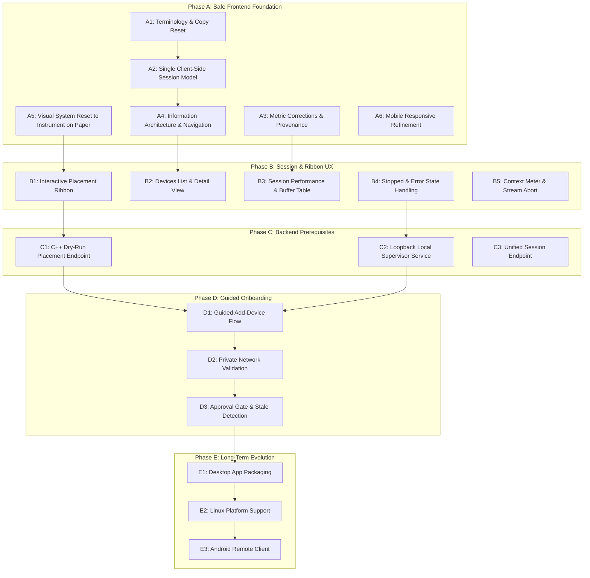

# Swarm — Design Blueprint Review, Technical Validation, and Implementation Plan

**Workspace:** `C:\Users\kunal\OneDrive\Desktop\swarm`  
**Date:** 2026-10-11  
**Author:** Antigravity AI Engineering & Architecture  
**Inputs Reviewed:**  
- `Swarm — Product Design and UX Blueprint.md`
- `Swarm — low-fidelity wireframes (The Session).html` (including all 5 decompressed artboards)
- `DECISIONS.md`
- `docs/DECISIONS_AND_LIMITATIONS.md`
- `docs/VALIDATION_STATUS.md`
- `docs/single_computer_local_dev_guide.md`
- `docs/audits/MILESTONE13_FINAL_CONSISTENCY_AUDIT.md`
- C++ Backend Source (`main.cpp`, `policy.h`, `estimator.h`, `tracker.h`, `config.h`, etc.)
- Frontend Codebase (`ui/src/`)

---

## 1. Executive Summary & Conceptual Recommendation

### 1.1 Core Recommendation: Adopt "The Session" (Concept B) with Architectural Modifications
We recommend **adopting the core product thesis of "The Session" (Concept B)** as the guiding vision for Swarm, while modifying its implementation assumptions to conform strictly to the physical and security realities of the C++ GGML/llama.cpp backend.

### 1.2 Rationale
1. **Physical Reality of Distributed LLMs:** In GGML and llama.cpp, model weights and tensor buffers are mapped and allocated across compute devices **at model load time**. Once loaded, layer placement cannot be altered dynamically without unmapping the context and reloading the model. Therefore, the "Session" (one model loaded with an immutable layer placement across a specific set of hardware resources) is the genuine atomic unit of Swarm.
2. **Elimination of Cognitive Tax:** The current prototype forces users to navigate five endpoint-shaped screens (**Chat**, **Activity**, **Workers**, **Nodes**, **Settings**). On a single laptop, the interface displays "2/2 Logical Nodes", "1 Physical Host", "Local Coordinator Gateway", "CUDA0 Backend", and "RPC Endpoint 50052" — using five technical nouns for one computer. Consolidating this into **Chat**, **Devices**, and **Session** (with Settings as a secondary utility) directly aligns the interface with human intent.
3. **The Placement Ribbon as Signature Graphic:** The proposed **placement ribbon** (a contiguous strip of layers color-coded by physical device and patterned by processor type) is an outstanding visualization. It replaces arbitrary metric cards with an immediate answer to Swarm's central technical question: *"Where is this model running, and how much is each machine carrying?"*
4. **Necessary Modifications:** The supplied Blueprint assumes certain capabilities that do not yet exist or cannot work as proposed:
   - *Browser Process Control:* A sandboxed web browser cannot spawn, restart, or kill native OS processes (`swarm.exe`, `llama-rpc-server.exe`) directly. A "Start Session" button requires a secure local supervisor or native shell.
   - *Plan-Before-Load:* The dry-run memory verdict shown in Wireframe 1 requires a new C++ endpoint (`/api/v1/placement/dry-run`). It cannot be calculated client-side without risking out-of-memory crashes.
   - *Unauthenticated RPC Protocol:* GGML RPC is unauthenticated, unencrypted TCP. A frontend "Approval Gate" badge provides zero transport security if port `50052` is exposed to a raw network. Device onboarding must mandate private network overlays (Tailscale / WireGuard).
   - *Crash Semantics:* When an RPC helper disconnects mid-generation, GGML asserts `RPC_STATUS_ASSERT` and aborts the coordinator (`0xc0000409`). Live recovery mid-stream is technically impossible under current GGML code; the UI must design for process restart, not live failover.

---

## 2. Discrepancy, Inconsistency, and Assumptions Register

| ID | Topic | Blueprint Proposal | Actual Repo & Runtime Reality | Severity / Impact | Recommended Resolution | User Decision Required? |
| :--- | :--- | :--- | :--- | :--- | :--- | :--- |
| **D-01** | **Activity Metric Mislabel** | Section 0 & 1.5 note that "Avg token latency 12.68 s" and "Last rate 7.3 tok/s" are mathematically incompatible. | **Confirmed defect.** Verified in `main.cpp` lines 1620–1627: `g_token_gen_seconds_sum` accumulates total generation time per request, and `g_token_gen_count` increments once per request. The division yields **average generation duration per request**, not latency per token. | **High** (Misleading performance data) | Relabel as "Avg Reply Generation Duration" (`fmtMs(avgGenMs)`), and compute true per-token latency as `g_token_gen_seconds_sum / g_tokens_generated_total`. | No (Clear bug fix) |
| **D-02** | **Wireframe Layer Split (34/3 vs 33/1/3)** | Wireframe 1 displays CPU 34 + GPU 3 layers; runtime audit shows CPU 33 + RPC 1 + GPU 3 layers. | Wireframe 1 is explicitly titled "Desktop first run" and represents a single computer prior to registering loopback RPC helpers. Wireframe 2 accurately represents the active cluster (L0–L32 CPU, L33 RPC0, L34–L36 CUDA0). | **Low** (Intentional scenario difference) | Document that Wireframe 1 is a single-machine standalone profile. Frontend must bind dynamically to `/backends` and never hardcode either allocation. | No |
| **D-03** | **Plan-Before-Load Dry Run** | Proposes that the UI shows whether a model "Fits", "Tight", or "Won't fit" before loading. | While `policy.h` has `PlacementPolicyEngine` and `ConservativeCapacityEstimator`, **no HTTP API endpoint exists** to run this prediction without starting model load. | **High** (Blocks Wireframe 1 functionality) | Build a new backend endpoint `POST /api/v1/placement/dry-run` that runs the estimator and returns integer layer capacity and headroom without loading weights. | Yes (Approve new C++ endpoint) |
| **D-04** | **Browser Process Lifecycle Control** | Wireframe 1 has "Start session", Wireframe 5 has "Stop session", and Blueprint proposes starting Swarm from the browser. | A web browser cannot execute native binaries or manage OS processes. `SettingsPanel` already notes that native process control is unavailable from the web. | **High** (Architectural feasibility) | Phased approach: Phase A/B provides copyable CLI scripts and auto-detect polling. Phase C designs a dedicated, secure local loopback supervisor service. | Yes (Approve supervisor scope) |
| **D-05** | **Helper Pairing & Approval Gate** | Proposes a pairing token and a Tailscale-style "Needs approval" gate in the UI before a helper gets layers. | GGML RPC is unauthenticated, unencrypted TCP. The existing telemetry bearer token only protects `/nodes/report`. An RPC worker on port `50052` can be sent tensors by anyone who can reach the port. GGML RPC does not support connection pausing or an approval handshake. | **Critical** (Security vulnerability if misunderstood) | Do not create a false sense of security with a frontend badge. Mandate transport-layer isolation (Tailscale / WireGuard). Implement true approval only at supervisor/proxy level. | Yes (Approve security boundaries) |
| **D-06** | **Helper Disconnect Recovery** | Proposes a "Paused" state and seamless recovery checklist when a helper is lost. | If a helper disconnects **idle**, HTTP 503 is returned. But if disconnected **mid-decode**, `rpc_dispatcher::work()` asserts, calling `GGML_ABORT` and terminating `swarm.exe` (Windows error `0xc0000409`). | **High** (Process survival limitation) | Clearly distinguish Idle Pause (process alive, retry possible) from Mid-Decode Crash (process terminated, coordinator restart required). | No |
| **D-07** | **Streaming Cancellation Semantics** | Blueprint marks as [Open] whether clicking "Stop" actually stops `llama_decode`. | **Verified working.** In `main.cpp` lines 1584–1587, if the HTTP client aborts the connection, `sink.write()` returns `false`, causing `main.cpp` to free the sampler and immediately terminate the decode loop. | **Info** (Validated capability) | Frontend can safely implement a "Stop Generating" button by calling `abort()` on the active `fetch` / `EventSource` controller. | No |
| **D-08** | **SSE Timing Metrics Payload** | Blueprint asks whether token speed and time-to-first-token are available in the stream. | `main.cpp` lines 1634–1643 emit a penultimate chunk: `{"timings":{"prompt_eval_ms":...,"gen_ms":...,"total_ms":...,"tokens_generated":...,"tokens_per_sec":...}}`. It does not include `time_to_first_token` directly, but `prompt_eval_ms` approximates it. | **Medium** (Telemetry alignment) | Calculate client-side elapsed time during generation, and use the penultimate chunk's `tokens_per_sec` and `prompt_eval_ms` for the completion footer. | No |
| **D-09** | **Memory Provenance & Attribution** | Proposes showing "Measured", "Set by you", "Estimated", and "Not available". | `api.ts` and `main.cpp` already track `measurement_status: "observed" \| "unavailable"` and `log_derived: true/false`. `NodeInfo` tracks `agent_reported`. | **Low** (Frontend styling) | Align frontend labels with the proposed vocabulary using the already available backend metadata fields. | No |
| **D-10** | **Physical vs Loopback RAM Reporting** | Blueprint notes that the red 7.7/7.8 GB RAM bar appears redundantly under both Host and RPC worker. | Loopback RPC workers run on `127.0.0.1` and share host RAM. `main.cpp` correctly tags them as `memory_scope: "shared_host"` and deduplicates memory in `/backends`. | **Medium** (Visual clarity) | Ensure the UI renders physical RAM gauges only once per physical computer, never under loopback helper sub-cards. | No |

---

## 3. High-Priority Technical & Architectural Validation

### 3.1 Layer Allocation and Wireframe Scenarios (Phase 3A)
- **The Evidence:** The current runtime cluster (Single Host Laptop running Coordinator `:8080` + Loopback RPC `:50052`) allocates 37 total layers:
  - Host CPU: 33 layers (`L0–L32`)
  - Loopback RPC0: 1 layer (`L33`)
  - Host CUDA0: 3 layers (`L34–L36`)
- **Wireframe Assessment:** 
  - *Wireframe 1 (Desktop First Run):* Shows CPU 34 (`L0–L33`) + GPU 3 (`L34–L36`). This is an **authentic single-computer standalone baseline** where no RPC worker has been configured.
  - *Wireframe 2 (Desktop Chat with Reply):* Shows CPU 33 (`L0–L32`), Test Helper 1 (`L33`), and GPU 3 (`L34–L36`). This matches the **exact 37-layer multi-backend runtime allocation**.
- **Architectural Requirement:** The frontend must never hardcode either allocation. All visual components (ribbon, cards, tables) must dynamically render the contents of the `/backends` response.

### 3.2 Model-Fit & Memory Verdicts (Phase 3B)
- **The Evidence:** Wireframe 1 shows `7.8 GB RAM · 2.4 GB free now`, `2.1 GB Model (37 layers)`, and a verdict: `Fits, with little to spare. Swarm keeps 1.0 GB free for the system (reserve tick)`.
- **Backend Reality:** `policy.h` implements `ConservativeCapacityEstimator::estimate_bytes_per_layer(n_ctx, bytes_per_layer)` with default headroom of 1024 MiB RAM and 256 MiB VRAM. When `SWARM_PLACEMENT_POLICY=resource_aware` or `dynamic` is active, it calculates integer layer capacities per candidate backend.
- **Feasibility:** Currently, this evaluation only runs during `main.cpp` startup when loading a model. If the capacity is insufficient, `main.cpp` terminates with exit code 1.
- **Architectural Verdict:** Simulating this calculation purely in the browser in TypeScript is dangerous because GGML layer sizing depends on specific tensor quantization metadata, context allocations, and GGML compute buffer estimates. 
- **Recommendation:** Implement a lightweight dry-run endpoint in C++ (`POST /api/v1/placement/dry-run`) taking `{ model_path, n_ctx, headroom_ram_bytes, headroom_vram_bytes }` and returning the predicted `PlacementPolicyResult` JSON without starting inference.

### 3.3 Device, Host, Processor, Worker, and Session Terminology (Phase 3C)
- **Evaluation:** The current prototype suffers from severe taxonomy overload. A single physical laptop is described as:
  1. "Node" (logical inventory record)
  2. "Worker" (worker manager thread)
  3. "Backend" (GGML placement target)
  4. "Gateway" (HTTP coordinator)
  5. "RPC Endpoint" (listening socket)
- **Proposed Hierarchy:**
  ```text
  Device (Physical Machine: "This computer" or "Studio PC")
   ├── Role: Host (runs coordinator & chat) or Helper (lends compute)
   ├── Processors: CPU, GPU (NVIDIA GTX 1050)
   └── Session Allocation: Layers L0–L32 (Host CPU), L33 (Loopback Helper), L34–L36 (Host GPU)
  ```
- **Clarity Assessment:** This mental model is exceptionally clear for both developers and home-lab operators. It immediately clarifies that loopback workers are simply in-process or local test helpers sharing the same host memory. Technical details (ports, backend IDs, buffer bytes) remain accessible under an expandable "Technical details" section.

### 3.4 Process Supervision and Local Security (Phase 3D)
- **Problem Statement:** The Blueprint proposes in-app controls to "Start session", "Reload session", and "Stop session". Web browsers cannot execute OS commands.
- **Minimum Safe Design for Future Supervisor (Phase C Scope):**
  1. *Network Boundary:* Must bind strictly to loopback (`127.0.0.1`) on a dedicated local port (e.g., `:8081`).
  2. *Origin & CSRF Defense:* Reject any request lacking a matching `Origin: http://127.0.0.1:*` or valid local session nonce.
  3. *Fixed Execution Allowlist:* Strict binary allowlist (`swarm.exe`, `llama-rpc-server.exe`). Absolutely zero shell interpolation or arbitrary command execution.
  4. *Explicit Process Tree Isolation:* Track child PIDs directly. Never issue broad `taskkill /F /IM swarm.exe`.
  5. *Graceful Termination & Port Verification:* Issue `SIGINT` / `WM_CLOSE`, poll for exit, and verify ports 8080 and 50052 are released before reporting completion.
- **Interim Rule (Phases A & B):** No supervisor will be built yet. The UI will display copyable PowerShell commands, tail the local log file, and poll `/health` to detect when the coordinator goes online or offline.

### 3.5 Remote-Device Onboarding and RPC Security (Phase 3E)
- **Security Assessment of GGML RPC:**
  - The GGML RPC protocol is an experimental, unauthenticated, unencrypted TCP stream.
  - The telemetry bearer token in Swarm only authenticates the HTTP `/nodes/report` endpoint. It provides **zero protection** to the RPC port `:50052`.
  - Exposing `:50052` to an untrusted local network allows any client on the subnet to connect, manipulate memory, or trigger fatal crashes.
- **Architectural Rule:**
  - A frontend "Approve" button does not protect an open TCP port.
  - Device onboarding must mandate transport-layer encryption and authentication via a **private mesh overlay (Tailscale or WireGuard)**.
  - The UI must actively warn users if the bind address is not loopback (`127.0.0.1`) or a recognized private overlay subnet (`100.x.y.z` for Tailscale, `10.x.y.z` for WireGuard).

### 3.6 Metrics and System States (Phase 3F)
- **Reachable vs. Participating:** The Blueprint correctly insists that `READY` in `WorkerManager` only means the network socket responded to a heartbeat ping. If the placement policy assigned 0 layers to that worker, it is `Idle (0 layers)` and does not participate in inference. The UI must clearly distinguish:
  - *Participating:* Reachable and assigned $\ge 1$ layers or buffers.
  - *Standby / Idle:* Reachable, but assigned 0 layers (due to insufficient memory or policy exclusion).
  - *Offline / Unreachable:* Socket failed to respond.
- **Memory Provenance:** Values must indicate whether they were:
  - `Measured` (live Win32 / DXGI query or agent telemetry)
  - `Configured` (virtual profile budget)
  - `Estimated` (policy engine prediction)
  - `Not available` (unsupported hardware, rendered distinctly from zero).
- **Inference Metrics:**
  - `tokens_per_sec`: Validated rate of the most recent autoregressive token generation loop.
  - `prompt_eval_ms`: Measured time for initial prompt ingestion.
  - `total_reply_duration_ms`: Total wall-clock time from prompt ingestion to stream completion.

### 3.7 First-Run and Recovery Workflow Classification (Phase 3G)

| Workflow / Feature | Classification | Technical Prerequisites |
| :--- | :--- | :--- |
| **First-Run Hardware Detection** | **Current Capability** | Already available via `/backends` and `/health` memory accounting. |
| **Plan-Before-Load Fit Preview** | **Backend Work** | Requires new `POST /api/v1/placement/dry-run` endpoint in C++. |
| **Start / Stop In-App Button** | **Requires Supervisor** | Cannot be executed from browser; requires Phase C local supervisor. |
| **CLI Command Copy + Auto-Detect** | **Frontend-Only Work** | Uses clipboard API + polling `/health`. Can be built immediately in Phase A. |
| **Idle Helper Disconnect (HTTP 503)** | **Current Capability** | Backend already handles gracefully with structured JSON. UI needs inline banner. |
| **Mid-Decode Crash Recovery** | **Blocked by GGML** | GGML aborts process on socket break. UI must show "Process Stopped" & guide restart. |
| **Private Network Warning** | **Frontend-Only Work** | Inspects hostname/IP in candidate address and warns on non-private IPs. |
| **Approval Gate for Onboarding** | **Requires Product Decision** | Meaningful only if implemented in coordinator/supervisor proxy. |

---

## 4. Assessment of Proposed Product Concept ("The Session")

### 4.1 Evaluation of Core Components

#### A. The Session Bar (Top Header)
- **Blueprint Proposal:** Consolidate chips into a single unified bar: `Qwen 2.5 3B Instruct · 2,048-token window · ● Ready · [2 devices]`.
- **Verdict: Strongly Endorsed.** Currently, the top bar has multiple redundant chips ("Inference Ready", "Server: running", "Strict Loopback", full file path). A unified session bar frees up vertical space and immediately answers the user's primary question: *"Can I ask a question right now?"*

#### B. The Placement Ribbon (Under Session Bar)
- **Blueprint Proposal:** A slim, full-width segmented line representing all model layers in order:
  - `Hue = Physical Device` (Host = Verdigris, Helper = Steel Blue)
  - `Fill = Processor Type` (GPU = Solid fill, CPU = Light tint with 1.5px border, Loopback Helper = Dashed border)
- **Verdict: Strongly Endorsed.** This is the single most distinctive visual asset proposed. It translates complex distributed GGML tensor allocation into an intuitive, physical graphic. Hovering or tapping a segment shows layer numbers, processor type, device ownership, and buffer byte allocations.

#### C. Replacing "Workers" and "Nodes" with "Devices"
- **Blueprint Proposal:** Eliminate separate Workers and Nodes screens. Introduce a single **Devices** view:
  - List of physical machines as rows (Host, Helper).
  - Expandable detail panel for memory, processors, and technical buffers.
  - Optional schematic topology layout for clusters with $\ge 2$ physical machines.
- **Verdict: Strongly Endorsed.** Having both a "Workers" panel and a "Nodes" panel in a distributed inference system creates endless confusion because "Workers" are processes and "Nodes" are inventory records. Merging them into physical **Devices** completely clarifies cluster state.

#### D. Three-Destination Navigation
- **Blueprint Proposal:** Nav rail with **Chat** (home), **Devices**, **Session**, and **Settings** (gear).
- **Verdict: Endorsed with Minor Clarification.**
  - *Chat:* Interactive inference workspace.
  - *Devices:* Cluster hardware management and onboarding.
  - *Session:* Detailed model placement table, memory accounting, and latency performance.
  - *Settings:* Runtime configuration, network bindings, and diagnostics.
- This represents a clean reduction from 5 disjointed tabs to 3 primary destinations.

#### E. Mobile Adaptation (390×844)
- **Blueprint Proposal:** Bottom navigation with **Chat**, **Cluster**, and **More**. Compact session bar and placement ribbon. 44px minimum touch targets.
- **Verdict: Strongly Endorsed.** Wireframes 4 and 5 demonstrate that mobile becomes a first-class remote monitor and chat client rather than a cramped desktop dashboard.

---

## 5. Visual and Interaction Specification

### 5.1 Palette & Aesthetic: "Instrument on Paper"
The Blueprint proposes moving from the current "Warm Engineering Workbench" (which it argues reads as generic grey cards with forest green pills) to an **"Oxidized Metals on Paper"** palette:

| Token Name | Hex Code | Semantic Role | Contrast vs. Paper (#FBFBF8) |
| :--- | :--- | :--- | :--- |
| `color-paper` | `#FBFBF8` | Primary background canvas | — |
| `color-sunken` | `#F1F1EB` | Recessed wells (user messages, code, metrics) | 1.1 : 1 |
| `color-rule` | `#DEDED6` | Hairline dividers | Decorative |
| `color-rule-strong` | `#C7C7BD` | Component borders, input outlines | 1.4 : 1 |
| `color-ink` | `#1C2024` | Primary high-contrast text | **15.8 : 1** (WCAG AAA) |
| `color-ink-2` | `#555D65` | Secondary text, labels | **6.5 : 1** (WCAG AAA) |
| `color-ink-3` | `#69717A` | Subdued metadata, timestamps | **4.8 : 1** (WCAG AA) |
| `color-verdigris` | `#1F6F66` | Primary brand accent, Host device, focus ring | **5.8 : 1** (WCAG AA) |
| `color-steel` | `#46598F` | Helper Device A hue | **6.5 : 1** (WCAG AA) |
| `color-plum` | `#7A4A6E` | Helper Device B hue | **6.7 : 1** (WCAG AA) |
| `color-brass` | `#8A6212` | Warning state, reserve tick, "Below reserve" | **5.3 : 1** (WCAG AA) |
| `color-brick` | `#A33A2C` | Error state, engine crash, fatal failure | **6.3 : 1** (WCAG AA) |

### 5.2 Typography System
- **UI & Primary Sans:** **Instrument Sans** (400, 500, 600) — self-hosted WOFF2. Clean, mechanical, human-scale sans-serif.
- **Monospace & Data:** **IBM Plex Mono** (400, 500) — self-hosted WOFF2. Tabular numerals for alignment in metrics, layers, buffer sizes, and IPs.
- **Display Accent:** **Instrument Serif** (400) — self-hosted WOFF2. Used exclusively for top headlines and model titles on Session and Setup. Adds distinctive editorial craftsmanship without cluttering data.
- **Strict Constraint:** Self-host all font files in `ui/public/fonts/`. Swarm is a local-first system that must work completely offline without CDN dependencies.

### 5.3 Surfaces & Structure (Eliminating "Card Sprawl")
- **Row-Based Anatomy:** Replace uniform boxy card containers with clean horizontal rows separated by hairline rules (`#DEDED6`).
- **No Tracked Uppercase Micro-Headings:** Replace `1. LOCAL COORDINATOR GATEWAY` with sentence-case typography (`Host · This computer`).
- **No Pill Badges for Normal States:** Healthy operational status is indicated by a simple solid ink dot (`● Ready`), not an enclosed green pill. Pill/chip styles are reserved strictly for states requiring user attention (`Needs approval`, `Below reserve`).

---

## 6. Phased Implementation Roadmap



### Phase A — Safe Frontend Foundation (Zero Backend Changes, Zero Risk)
*Objective: Implement the new information architecture, terminology, metrics, and visual design system within the existing React app using only existing endpoints (`/health`, `/backends`, `/nodes`, `/metrics`).*

1. **Item A1: Terminology & Copy Reset (FE)**
   - *Purpose:* Eliminate "node", "gateway", "backend", and "worker" from primary views. Adopt "Device", "Host", "Helper", "Processor", and "Session".
   - *Files Affected:* `ui/src/components/`, `ui/src/types/api.ts`.
   - *Acceptance Criteria:* In a 10-second inspection, a new user can correctly identify how many physical computers are active.
2. **Item A2: Unified Client-Side Session State Model (FE)**
   - *Purpose:* Create a custom React hook `useSwarmSession()` that concurrently polls `/health`, `/backends`, and `/nodes`, unifying them into a single coherent state model before passing data to panels.
   - *Files Affected:* `ui/src/hooks/useSwarmSession.ts`.
   - *Acceptance Criteria:* Zero discrepancies between screens; the 37-layer breakdown (CPU 33, RPC 1, CUDA 3) matches on every screen.
3. **Item A3: Metric Corrections & Provenance Labeling (FE)**
   - *Purpose:* Fix the Activity screen metric calculation. Relabel `12.68 s` to "Avg Generation Time per Request". Add provenance suffixes ("Measured", "Estimated", "Not available").
   - *Files Affected:* `ui/src/components/BackendsPanel.tsx`.
   - *Acceptance Criteria:* Generation rate (tok/s) and reply latency are mathematically coherent.
4. **Item A4: Four-Destination Information Architecture (FE)**
   - *Purpose:* Replace five tabs with **Chat**, **Devices**, **Session**, and **Settings** (gear).
   - *Files Affected:* `ui/src/App.tsx`, `ui/src/components/Sidebar.tsx`, `ui/src/components/TopBar.tsx`.
   - *Acceptance Criteria:* Top bar chips collapse into unified Session Bar (`Model · Context · State · Devices`).
5. **Item A5: Visual System Reset to "Instrument on Paper" (FE)**
   - *Purpose:* Implement CSS variables for paper `#FBFBF8`, ink `#1C2024`, verdigris `#1F6F66`, brass `#8A6212`, brick `#A33A2C`. Self-host Instrument Sans, IBM Plex Mono, and Instrument Serif fonts. Remove card borders and uppercase tracked labels.
   - *Files Affected:* `ui/src/index.css`, `ui/public/fonts/`.
   - *Acceptance Criteria:* All text meets WCAG AAA/AA contrast against paper.
6. **Item A6: Mobile Structure (FE)**
   - *Purpose:* Implement bottom bar with Chat / Cluster / More. Ensure zero horizontal scroll down to 320px viewport width.
   - *Files Affected:* `ui/src/components/Sidebar.tsx`, `ui/src/index.css`.
   - *Acceptance Criteria:* Chat and Cluster monitor fully readable at 320px and 390px widths.

---

### Phase B — Session UX & Ribbon Visualization (Frontend Focus)
*Objective: Build the signature placement ribbon, consolidated Devices screen, and resilient lifecycle states.*

1. **Item B1: Interactive Placement Ribbon (FE)**
   - *Purpose:* Implement the layer ribbon component directly under the session bar.
   - *Features:* Segments proportional to assigned layer counts; color-coded by device hue; pattern-coded by processor (GPU solid, CPU light tint, Loopback helper dashed). Interactive hover/tap popover displaying layer numbers, buffer bytes, and device name.
   - *Acceptance Criteria:* Total ribbon segment count equals model layer count (37). Full keyboard navigation and ARIA text labels.
2. **Item B2: Consolidated Devices Screen (FE)**
   - *Purpose:* Merge `WorkersPanel.tsx` and `NodesPanel.tsx` into a single `DevicesPanel.tsx`.
   - *Features:* Clean row-based list showing physical machines. Single host RAM bar with reserve marker. Expandable detail panel showing processors, layer ranges, buffer allocations, and connection details.
   - *Acceptance Criteria:* Loopback helpers are explicitly identified as running on "This computer" and do not produce duplicate RAM bars.
3. **Item B3: Session Performance & Buffer Accounting (FE)**
   - *Purpose:* Elevate `BackendsPanel.tsx` into `SessionPanel.tsx`.
   - *Features:* Model specification header (file, size, layers, context). Full buffer allocation breakdown table (Model, KV, Compute). Performance strip showing recent reply speeds.
   - *Acceptance Criteria:* Displays "Why this split?" explanatory text confirming whether GGML placement matched policy predictions.
4. **Item B4: Resilient Stopped & Error State Handling (FE)**
   - *Purpose:* Gracefully handle coordinator process termination.
   - *Features:* When `/health` fails to respond, UI transitions to "Stopped" state, dims the last-known placement ribbon, preserves the user's prompt, displays the exact PowerShell launch command with copy button, and polls for automatic recovery.
   - *Acceptance Criteria:* Killing the coordinator process produces a clear recovery screen within 3 seconds, without crashing or blanking the browser.
5. **Item B5: Context Meter & Streaming Cancellation (FE)**
   - *Purpose:* Add token usage meter to composer (`312 / 2,048`) and a working "Stop" button during generation.
   - *Features:* Tapping "Stop" calls `abort()` on the fetch controller, successfully halting the server's decode loop.
   - *Acceptance Criteria:* Generation stops immediately on user click; prompt remains in composer.

---

### Phase C — Backend Prerequisites (Requires Backend Engineering)
*Objective: Implement necessary C++ backend extensions to support dry-run predictions and process supervision.*

1. **Item C1: C++ Dry-Run Placement Endpoint (BE)**
   - *Purpose:* Allow the UI to query predicted layer splits and memory fit verdicts before loading a model.
   - *Implementation:* Expose `PlacementPolicyEngine::evaluate()` via `POST /api/v1/placement/dry-run`.
   - *Request Payload:* `{ "model_path": string, "n_ctx": int, "headroom_ram_bytes": uint64, "headroom_vram_bytes": uint64 }`.
   - *Response:* Returns predicted split per device, headroom analysis, and boolean `fits_in_memory`.
   - *Acceptance Criteria:* Selecting an oversized model in Setup displays "Won't fit" with accurate missing byte counts, without starting model load.
2. **Item C2: Secure Loopback Local Supervisor (BE / Daemon)**
   - *Purpose:* Provide safe, native process lifecycle management for the coordinator and local helpers.
   - *Implementation:* Lightweight local service bound exclusively to `127.0.0.1:8081` with origin checking and CSRF tokens. Fixed binary allowlist (`swarm.exe`, `llama-rpc-server.exe`).
   - *Capabilities:* `start_session`, `stop_session`, `restart_session`, `get_process_status`, `tail_logs`.
   - *Acceptance Criteria:* User can click "Start session" in Setup to launch Swarm without opening a terminal window.
3. **Item C3: Unified `/session` REST Endpoint (BE)**
   - *Purpose:* Provide an authoritative, single-request endpoint combining health, placement, buffers, and node inventory.
   - *Acceptance Criteria:* Eliminates client-side multi-endpoint correlation.

---

### Phase D — Guided Onboarding & Private Networking (Both)
*Objective: Make adding a second computer safe, guided, and resistant to network exposure vulnerabilities.*

1. **Item D1: Guided Add-Device Sheet (FE + Scripting)**
   - *Purpose:* Step-by-step onboarding flow for adding a helper device.
   - *Features:* Step 1: Private network check. Step 2: Generate per-device launcher command. Step 3: Wait for helper reachability. Step 4: Plan dry-run split. Step 5: Reload session.
   - *Acceptance Criteria:* A user can connect a second PC without manual environment variable editing.
2. **Item D2: Private Network Validation & Warning (FE)**
   - *Purpose:* Prevent accidental exposure of unauthenticated RPC sockets to open networks.
   - *Implementation:* Validate candidate IP addresses. If an IP is outside loopback (`127.0.0.1`) or private VPN ranges (`100.x.y.z`, `10.x.y.z`), show a blocking warning requiring VPN setup.
   - *Acceptance Criteria:* Warns user against open LAN exposure.
3. **Item D3: Stale Telemetry & Idle Helper Handling (Both)**
   - *Purpose:* Handle network workers that stop reporting.
   - *Implementation:* If telemetry is older than 30 seconds, mark device as `Stale`. If a worker receives 0 layers, mark as `Idle (0 layers)`.

---

### Phase E — Long-Term Cross-Platform Evolution (Future Scope)
1. **Item E1: Desktop Shell Packaging (Electron / Tauri):** Native OS window, system tray menu, start on login, background helper service.
2. **Item E2: Portable Linux Implementation:** Replace Win32 memory queries with portable `/proc/meminfo` and sysfs hardware discovery.
3. **Item E3: Android Remote Client:** Authenticated mobile client connecting to desktop Swarm host over Tailscale.
4. **Item E4: Android-as-Helper Research:** Deep investigation into Android OS background thread throttling, battery optimization, and thermal throttling before attempting mobile compute offloading.

---

## 7. User Decisions Matrix

| Decision | Available Options | Technical Tradeoffs | Recommended Option |
| :--- | :--- | :--- | :--- |
| **1. Product Concept Adoption** | **Option A:** Keep current 5-screen Warm Workbench dashboard.<br>**Option B:** Adopt "The Session" (3 destinations + Placement Ribbon). | Option A maintains status quo but perpetuates cognitive overload and taxonomy confusion. Option B aligns the UI with physical GGML loading reality and provides a signature data visualization. | **Option B (The Session):** Adopt 3 destinations (Chat, Devices, Session) + persistent ribbon. |
| **2. Vocabulary Reset** | **Option A:** Keep Node / Worker / Gateway / Backend / RPC.<br>**Option B:** Adopt Device / Host / Helper / Processor / Session. | Option A exposes low-level C++ class names that confuse users on single laptops. Option B creates an intuitive physical mental model while retaining technical details in expandable drawers. | **Option B:** Adopt physical hierarchy (Device -> Host/Helper -> Processor). |
| **3. Local Supervisor Scope** | **Option A:** No supervisor; retain manual PowerShell scripts & auto-detect.<br>**Option B:** Approve Phase C local loopback supervisor. | Option A requires users to open terminal windows to start/stop Swarm. Option B enables native one-click in-app lifecycle controls but adds a new backend component. | **Option B in Phase C:** Implement Phase A/B with scripts + auto-detect; build secure supervisor in Phase C. |
| **4. Dry-Run Placement Endpoint** | **Option A:** Simulate placement client-side in TypeScript.<br>**Option B:** Add `POST /api/v1/placement/dry-run` in C++. | Option A risks inaccurate predictions and out-of-memory crashes. Option B leverages the existing C++ `PlacementPolicyEngine` deterministically. | **Option B:** Add C++ dry-run endpoint in Phase C. |
| **5. Chat History Persistence** | **Option A:** In-memory session only (cleared on reload).<br>**Option B:** Local browser IndexedDB persistence across sessions. | Option A is simpler and avoids storing prompts. Option B matches user expectations for chat tools. | **Option B (IndexedDB):** Store conversations locally in browser storage in Phase B. |
| **6. Remote Network Security Target** | **Option A:** Allow raw LAN IP connections.<br>**Option B:** Mandate/recommend private mesh VPN (Tailscale/WireGuard). | Option A exposes unauthenticated, unencrypted GGML RPC to the local network. Option B guarantees transport-level encryption and access control. | **Option B:** Recommend Tailscale/WireGuard for all multi-computer setups. |

---

## 8. Implementation Handoff Prompt

*(When ready for implementation, the following prompt should be provided to the coding agent to begin Phase A:)*

```markdown
# Swarm Phase A Implementation — Information Architecture, Vocabulary, and Visual System Foundation

Workspace: `C:\Users\kunal\OneDrive\Desktop\swarm`

You are implementing Phase A of the Swarm Design & Architecture Modernization, based on `docs/Swarm — Design Blueprint Review, Technical Validation, and Implementation Plan.md`.

## Core Directives & Boundaries
- Do NOT modify the C++ backend, inference engine, or CMake files in this phase.
- Do NOT alter runtime network bindings, firewall rules, or the Milestone 12 baseline.
- All work is strictly in `ui/`.
- Maintain 100% build and lint passing status (`npm run build` and `npm run lint`).

## Tasks to Execute:
1. **Typography & Styling (`ui/src/index.css`):**
   - Download/bundle self-hosted WOFF2 font files for Instrument Sans, IBM Plex Mono, and Instrument Serif in `ui/public/fonts/`.
   - Update CSS variables with the "Instrument on Paper" palette (`--color-paper: #FBFBF8`, `--color-sunken: #F1F1EB`, `--color-rule: #DEDED6`, `--color-ink: #1C2024`, `--color-verdigris: #1F6F66`, `--color-brass: #8A6212`, `--color-brick: #A33A2C`).
   - Replace boxy card containers (`.card`) with clean, hairline-separated rows.
   - Remove uppercase tracked section labels; use clean sentence-case typography.

2. **Derived Session Hook (`ui/src/hooks/useSwarmSession.ts`):**
   - Create a unified hook that polls `/health`, `/backends`, and `/nodes`.
   - Compute a single authoritative cluster state object representing physical Devices, Processors (CPU/GPU), Host, Helpers, and Layer Allocations.
   - Enforce host RAM deduplication for loopback workers so total host RAM is never counted twice.

3. **Four-Destination Navigation & Top Bar (`App.tsx`, `TopBar.tsx`, `Sidebar.tsx`):**
   - Collapse top bar chips into a unified Session Bar: `[Model Name] · [Context Window] · ● [State] · [N devices]`.
   - Update navigation rail to four destinations: `Chat`, `Devices`, `Session`, and `Settings` (gear icon).
   - On mobile viewports (<768px), render a clean bottom navigation bar with `Chat`, `Cluster`, and `More`.

4. **Metric Correction (`BackendsPanel.tsx` / `SessionPanel.tsx`):**
   - Correct the mislabeled "Avg Token Latency". Display "Avg Reply Generation Time" based on `metrics.tokenGenSecondsSum / metrics.tokenGenCount`.
   - Display true token generation rate from `tokens_per_sec`.
   - Add provenance indicators ("Measured", "Estimated", "Not available").

5. **Validation:**
   - Run `npm run lint` and `npm run build`.
   - Test viewports at 1440px desktop, 768px tablet, and 390px/320px mobile.
```

---

## 9. Conclusion

The supplied Blueprint and wireframes provide an inspiring, highly competent design vision that correctly identifies the central flaw of Swarm's current interface: **it is structured around internal developer endpoints rather than the user's mental model.**

By transitioning from the generic dashboard paradigm to **The Session (with the placement ribbon, unified Devices view, and "Instrument on Paper" design system)**, Swarm will achieve a best-in-class product experience that is technically honest, aesthetically distinctive, and deeply satisfying to use.

**Current Status:** Review and technical plan completed. **All coding is halted pending your explicit approval of the user decisions outlined in Section 7.**
