# Swarm — Phase A Safe Frontend Foundation Implementation Report

**Workspace:** `C:\Users\kunal\OneDrive\Desktop\swarm`  
**Execution Phase:** Phase A only (Safe Frontend Foundation)  
**Approved Concept:** Concept B ("The Session")  
**Design System:** Instrument on Paper  
**Status:** **Completed & Verified**  

---

## 1. Executive Summary & Verification Highlights

Phase A has been successfully implemented and verified across desktop and mobile viewports. In accordance with authorization constraints:
- **Zero backend changes:** The C++ coordinator (`src/`), GGML/llama.cpp inference engine, RPC protocol, local scripts (`scripts/`), official model (`models/`), and Milestone 12 baseline (`backups/milestone12-final-baseline-20261011/`) remain completely intact.
- **Frontend transformation (`ui/`):** The previous 5-endpoint dashboard was replaced with the 4-destination Session architecture: **Chat**, **Devices**, **Session**, and **Settings**.
- **Data integrity & accurate taxonomy:** 
  - Physical machine inventory is separated from processes. The loopback RPC worker (`127.0.0.1:50052`) is clearly identified as a local test helper running on the same host, and its RAM is deduplicated with the physical host's 7.84 GB RAM.
  - The mislabeled latency metric was corrected: average whole-request duration is now explicitly labeled **Average generation time per request** (12.68s over 3 requests), kept distinct from the real-time token generation rate (7.3 tok/s).
  - The model layer allocation across processors is accurately rendered in a compact placement ribbon (Host CPU: L0–L32 [33], Test Helper RPC: L33 [1], Host GPU CUDA0: L34–L36 [3]), accompanied by the honest caption: *"Placement is fixed when the session loads."*
- **Code quality:** `npm run lint` (Oxlint) and `npm run build` (`tsc -b && vite build`) passed with **0 errors and 0 warnings**.
- **Live inference:** Tested real prompt submission and SSE streaming response in the browser.

---

## 2. New Information Architecture (Concept B: The Session)

The navigation was restructured from five endpoint-centric tabs (`chat`, `workers`, `backends`, `nodes`, `settings`) into four user-centric destinations:

```mermaid
graph TD
    AppShell["Swarm Main Shell"] --> SessionBar["Sticky Top Session Bar: ●—●—● Swarm | Model | Context | State | Device count"]
    AppShell --> Nav["Left Sidebar / Mobile Bottom Bar"]
    
    Nav --> Chat["1. Chat (Primary Entry Point)"]
    Chat --> ChatRibbon["Compact Placement Ribbon"]
    Chat --> ChatThread["Quiet Text Thread (Paper Style)"]
    Chat --> ChatComposer["Composer (Token Meter, Stop Button, Preserved Prompt)"]
    
    Nav --> Devices["2. Devices (Physical Machines)"]
    Devices --> HostCard["This Computer (Physical Host: CPU + GTX 1050 VRAM + Host RAM with Reserve)"]
    Devices --> HelperCard["Helper Device / Loopback Test Helper (Deduplicated RAM)"]
    Devices --> TechDetails["Technical Details Drawer (Ports, PIDs, Sockets, Endpoints)"]
    
    Nav --> SessionView["3. Session (Model, Buffers & Performance)"]
    SessionView --> ModelRow["Model Identity & Context Window"]
    SessionView --> FullRibbon["Interactive Layer Placement Ribbon"]
    SessionView --> TensorTable["Tensor Buffer Table (Model, KV Cache, Compute Buffers)"]
    SessionView --> RamHeadroom["Host Physical RAM & Reserve Marker (1.0 GB)"]
    SessionView --> CorrectedMetrics["Corrected Telemetry: Rate (7.3 tok/s) vs Duration (12.68s)"]
    
    Nav --> Settings["4. Settings (Secondary Utility Access)"]
    Settings --> RuntimeEnv["Runtime Parameters & Placement Policy"]
    Settings --> ScriptTooling["Audited PowerShell Launch/Test/Stop Commands"]
```



---

## 3. Implemented Phase A Changes

### A. Navigation & Top Session Bar
- **Top Session Bar (`TopBar.tsx`):**
  - Brand mark `●—●—● Swarm`.
  - Configured model display with title fallback and token window badge (`2,048-token window`).
  - Honest single-word session lifecycle badge (`● Ready`, `● Generating`, `● Paused`, `● Not running`).
  - Interactive device counter chip (`[2 devices]`) that navigates directly to the Devices view.
- **Unified 4-destination Navigation (`Sidebar.tsx`):**
  - Four items: **Chat**, **Devices**, **Session**, **Settings**.
  - Desktop: Minimal vertical row with 2px accent border indicator on the active item.
  - Mobile: Clean bottom navigation bar with responsive icon labels.

### B. Unified Derived Session State Hook (`useSwarmSession.ts`)
- Consolidates responses from `/health`, `/backends`, and `/nodes` without introducing any new endpoints or duplicating backend logic.
- Accurately classifies devices into physical machines (`host` vs `helper`) and identifies loopback helpers (`isLoopback: true`).
- Enforces host physical RAM deduplication so loopback RPC workers do not falsely double the system RAM count.
- Evaluates memory headroom against the 1.0 GB safety reserve threshold (`DEFAULT_RESERVE_RAM = 1024 * 1024 * 1024`).
- Handles missing or disconnected backend states honestly with `not_running` state derivation.

### C. Placement Ribbon Foundation (`PlacementRibbon.tsx`)
- Visualizes layer placement derived dynamically from authoritative `/backends` data.
- Visual encoding:
  - **Host CPU:** Light accent fill with solid accent border (33 layers: L0–L32).
  - **Test Helper (Loopback RPC):** Subdued surface fill with dashed steel border (1 layer: L33).
  - **Host GPU (CUDA0):** Solid accent fill (3 layers: L34–L36).
- Accessible keyboard navigation and hover tooltips showing device name, layer range, and tensor buffer weight bytes.
- Direct label caption and explicit notice: *"Placement is fixed when the session loads."*

### D. Physical Hardware Taxonomy & Devices Screen (`DevicesPanel.tsx`)
- Merges worker and node inventories into a physical machine perspective.
- Displays **This computer** as the primary host with its physical RAM (7.84 GB total, reserve marker at 1.0 GB) and local processors (Host CPU + NVIDIA GeForce GTX 1050 4 GB VRAM).
- Displays the loopback helper as a **Test helper** explicitly marked as a local process sharing host RAM.
- Technical details (ports, loopback addresses, process endpoints) are grouped in an expandable disclosure labeled **Technical details**.
- "Add device" modal provides clear guidance on private overlay network requirements (Tailscale/WireGuard), reiterating that unauthenticated GGML RPC must never be exposed to public networks.

### E. Session Screen & Metric Corrections (`SessionPanel.tsx`)
- Consolidates the former Backends and Activity screens.
- Full layer allocation table detailing:
  - Processor name and backend type.
  - Assigned layer range.
  - Model weights buffer bytes (`fmtBytes`).
  - KV cache buffer bytes (`fmtBytes`).
  - Compute buffer bytes (`fmtBytes`).
- **Metric Correction:** Fixed the telemetry mislabel identified in the audit. Relabeled the whole-response generation metric as **Average generation time per request** (12.68s), keeping it distinctly separated from the active token generation rate (7.3 tok/s).

### F. Chat Workspace & Honest Stopped States (`ChatPanel.tsx`)
- Placed the compact placement ribbon at the top of the chat panel.
- Restyled messages to the "Instrument on Paper" aesthetic: assistant messages render as clean, readable text without rounded card bubbles; user messages render in a subtle sunken well (`#F1F1EB`).
- Integrated a live token meter in the composer: shows estimated prompt tokens against the 2,048-token context window (`est / 2,048 tokens`).
- Added an explicit **Stop** button that immediately halts active SSE streams by triggering the fetch `AbortController`.
- **Honest stopped state:** When the coordinator is offline, the interface displays an honest disconnected notice, preserves any unsent input in the composer, and provides copyable PowerShell commands from the audited scripts.

### G. Visual Design System ("Instrument on Paper")
- Centered design tokens in `ui/src/index.css`:
  - Paper: `#FBFBF8`
  - Sunken surface: `#F1F1EB`
  - Hairline border: `#DEDED6`
  - Strong hairline: `#CDD3CA`
  - Primary ink: `#1C2024`
  - Secondary ink: `#5C646C`
  - Muted verdigris accent: `#1F6F66`
  - Steel blue accent: `#46598F`
  - Brass warning: `#8A6212`
  - Brick error: `#A33A2C`
- Local WOFF2 font extraction into `ui/public/fonts/`:
  - `InstrumentSans-Regular.woff2`
  - `InstrumentSans-LatinExt.woff2`
  - `IBMPlexMono-Regular.woff2`
  - `InstrumentSerif-Regular.woff2`
- Clean typography hierarchy with reliable system fallbacks (`-apple-system`, `Segoe UI`, `monospace`).

---

## 4. Verification & Acceptance Results

### A. Build & Lint Validation
```bash
# Linter check
> ui@0.0.0 lint
> oxlint
Found 0 warnings and 0 errors. Finished in 71ms on 20 files.

# Production build check
> ui@0.0.0 build
> tsc -b && vite build
✓ 1920 modules transformed.
dist/index.html                   0.45 kB │ gzip:  0.28 kB
dist/assets/index-BSusLMF2.css   14.72 kB │ gzip:  4.08 kB
dist/assets/index-BiTVIJci.js   281.64 kB │ gzip: 84.12 kB
✓ built in 1.16s
```

### B. Live Inference & Runtime Verification
- Verified active backend processes on localhost:
  - Coordinator: `127.0.0.1:8080` (PID 17152)
  - GGML RPC Worker: `127.0.0.1:50052` (PID 26048)
  - Vite Dev Server: `127.0.0.1:5173` (PID 2636)
- Sent live prompt `"hi"` via Chat interface:
  - Received streaming response: *"Hello! How can I assist you today?"*
  - Measured response timings: `10 tok`, `14.2 tok/s`, `704 ms gen`.

### C. Visual & Responsive Viewport Evidence
Screenshots were captured and archived in `artifacts/ui_screenshots/`:

| Viewport | Screen / State | Screenshot File |
| :--- | :--- | :--- |
| **Desktop (1440x900)** | Chat View with Session Bar & Placement Ribbon | `chat_view_desktop_1791719788378.png` |
| **Desktop (1440x900)** | Devices View (Host RAM + Test Helper Deduplication) | `devices_view_desktop_1791719800137.png` |
| **Desktop (1440x900)** | Devices Technical Details Drawer (Sockets & Ports) | `devices_technical_details_desktop_1791719812500.png` |
| **Desktop (1440x900)** | Session View (Buffer Allocations & Corrected Metrics) | `session_view_desktop_1791719826741.png` |
| **Desktop (1440x900)** | Session Performance Metrics Detail | `session_metrics_desktop_1791719836281.png` |
| **Desktop (1440x900)** | Settings View (CLI Controls & Diagnostics) | `settings_view_desktop_1791719849727.png` |
| **Desktop (1440x900)** | Live Chat Inference Response | `chat_response_done_desktop_1791719933975.png` |
| **Mobile (390x844)** | Mobile Chat View with Ribbon & Bottom Nav | `mobile_chat_view_1791719949083.png` |
| **Mobile (390x844)** | Mobile Devices View | `mobile_devices_view_screen_1791719988618.png` |
| **Mobile (390x844)** | Mobile Session View | `mobile_session_view_1791720164099.png` |

---

## 5. Scope Boundaries: Items Explicitly Deferred

In strict compliance with the user mandate, the following items remain deferred to Phase B or later phases:
- **No C++ backend changes:** No `POST /api/v1/placement/dry-run` or new C++ coordinator endpoints were created.
- **No native process supervisor:** Did not build a background service or browser start/stop bridge. The UI presents copyable PowerShell commands instead.
- **No remote-device pairing gates:** Did not add pairing tokens or approval barriers over unauthenticated RPC.
- **No network topology alterations:** RPC remains strictly bound to loopback `127.0.0.1:50052` without exposing unauthenticated RPC ports.
- **No client storage persistence:** No IndexedDB chat persistence added.
- **No platform porting:** No Android-as-worker, native Tauri/Electron bundling, or Linux porting code introduced.

---

## 6. Files Changed in Phase A

```
ui/
├── public/
│   └── fonts/
│       ├── InstrumentSans-Regular.woff2
│       ├── InstrumentSans-LatinExt.woff2
│       ├── IBMPlexMono-Regular.woff2
│       └── InstrumentSerif-Regular.woff2
├── src/
│   ├── index.css                   # Instrument on Paper design tokens & font-face rules
│   ├── App.tsx                     # 4-destination routing & TopBar view bindings
│   ├── hooks/
│   │   └── useSwarmSession.ts      # Unified derived session state hook
│   └── components/
│       ├── TopBar.tsx              # Compact session bar with brand, model, state & device chip
│       ├── Sidebar.tsx             # 4-destination navigation with active indicators
│       ├── PlacementRibbon.tsx     # Dynamic layer distribution ribbon with tooltips
│       ├── DevicesPanel.tsx        # Physical computer inventory & technical details
│       ├── SessionPanel.tsx        # Buffer allocation table, RAM headroom, corrected metrics
│       └── ChatPanel.tsx           # Placement ribbon, quiet text rows, composer meter, offline state
```

---

## 7. Conclusion & Next Step Authorization Boundary

Phase A is complete, verified, and stable. The frontend now accurately communicates Swarm's distributed architecture while preserving all C++ inference and networking code. 

**Work has stopped here.** Phase B will begin only upon explicit user approval.
